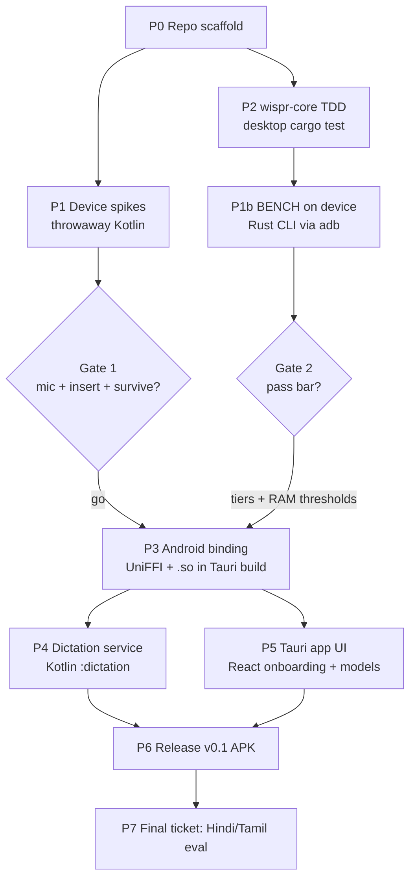

# Wispr Free — MVP plan (Android, English)

**Executable tickets:** GitHub issues #1–#51 under the pinned epic [#52 MVP roadmap](https://github.com/forked-online/wispr-free/issues/52) (milestones per phase, `blocked by` links, labels `owner:*`/`size:*`/`gate`). This plan keeps the invariants, gates and edge cases; the issues carry the steps. Ticket ids `Txx` are in each issue title.

Resumable from this file alone. Read first: `STATUS.md`, then `decisions/0001`–`0005`. Product scope: `/PRODUCT.md`. Evidence: `research/*.md`.

**MVP done =** on the iQOO Neo 10R, a user installs the signed APK from GitHub Releases, completes onboarding, downloads the recommended model, and dictates into WhatsApp, Gmail and Chrome through the floating bubble. Text inserts at the cursor or the user gets Copy. Everything runs offline after the model download, and the BENCH pass bar holds.

## Steer: invariants no ticket may break
1. Never write into a field other than the snapshotted one; never send/submit (0004).
2. Mic opens only on an explicit tap and closes on ✓, ×, focus loss or service teardown. Audio never touches disk.
3. Clipboard writes only on an explicit Copy tap.
4. No field text, transcript or audio in logs, crash reports or analytics. There is no telemetry.
5. A failed or partial model download never disables the active model (atomic install).
6. Every size, offset or count from a file, the network or Android is bounds-checked before use; no `as usize` on untrusted values. Model file names are validated against path traversal.
7. TDD: failing test first, shown red for the right reason, then green; full suite green before any done-claim.
8. No new dependency beyond those named in this plan without asking the user.

## Phases and gates

P1 and P2 run in parallel. Gate 1 failing means stop and re-plan with the user: the core UX depends on it.

### P0 — Repo scaffold
- P0.1 Add `LICENSE` (GPL-3.0 full text from gnu.org) and a `NOTICE`/third-party list stub that P5.4 later fills from real dependencies.
- P0.2 Cargo workspace: `crates/wispr-core` (lib, no Tauri deps), `crates/wispr-android` (cdylib binding, P3), `app/` (Tauri v2 + React + TS strict, pnpm). Landing page stays at the repo root.
- P0.3 CI (GitHub Actions): `cargo fmt --check`, `cargo clippy -D warnings`, `cargo test -p wispr-core`, `pnpm tsc --noEmit`, `pnpm test`. Android build job added in P3.
- **Done:** CI green on an empty-but-real skeleton; `cargo test` runs one real test.

### P1 — Device spikes (throwaway, `spikes/android-a11y/`, plain Kotlin project, never shipped)
Run on the iQOO Neo 10R. First record `getprop ro.build.version.release`, `ro.soc.model`, `ro.product.cpu.abi` and the page size into `research/device-iqoo-neo-10r.md`. Exact steps and pass criteria are in `research/android-platform.md` (table at its end) and `research/tauri-architecture.md`.

| Spike | Question | Blocks |
|---|---|---|
| AP-S1 / TA-S2 | Mic records from the a11y service with no FGS while WhatsApp is foreground? | Gate 1 |
| AP-S2 | If not: is a `microphone` FGS start allowed from the bubble tap? | Gate 1 |
| AP-S7 | Bubble overlay keeps the IME up and the editor focused; tap and drag work | Gate 1 |
| AP-S5 / AP-S6 | `commitText` and `SET_TEXT` matrix: WhatsApp, Gmail to/subject/body, Chrome URL + `<textarea>` + contenteditable, a Compose field, mid-draft insert, selection replace | Gate 1, fills 0004 |
| AP-S3 | Concurrency: Gboard voice typing, a phone call, another recorder | informs P4 |
| AP-S8 | Restricted settings by install path: browser → vivo installer, `adb install`, Obtainium | P5 onboarding copy |
| AP-S9 | Password / banking / sensitive fields get no bubble | P4 |
| SOAK | Service survives 6 h idle + a reboot with and without the vivo whitelist steps (`research/distribution-device.md` checklist) | Gate 1 |

**Gate 1 = go** if (AP-S1 or AP-S2) and AP-S7 pass, at least one insertion path works in WhatsApp and Gmail, and the service survives SOAK with the whitelist steps. Record results plus the dumpsys output in `research/device-iqoo-neo-10r.md` and update decisions 0002/0004.

### P2 — `wispr-core` (Rust, TDD, desktop `cargo test`)
Shared fixtures in `crates/wispr-core/tests/fixtures/*.json` are platform-neutral so desktop can reuse them later.

| Ticket | Scope | Key failing tests to write first |
|---|---|---|
| P2.1 Manifest | `ModelManifest` serde types: id, tier, languages, license, attribution, HF commit URL, sha256, size_bytes, files[] | rejects unknown tier; rejects size 0 or > 2 GiB; rejects file names with `/`, `..`, absolute paths or NUL; round-trips a real entry |
| P2.2 Verified download | Streaming SHA-256 + size cap into `models/.tmp-<id>/`, then atomic rename; resumable is out of scope | wrong hash → error and temp dir removed; oversize stream aborts at the cap without allocating it; success leaves exactly the manifest files; an existing active model is untouched on any failure |
| P2.3 Model store | install/list/delete/activate; `active-model.json` atomic write; deleting the active model is refused | concurrent read during write sees old-or-new, never partial; corrupt JSON → treated as "no active model", not a panic |
| P2.4 Recommend | `recommend_model(total_ram_bytes, &Tiers) -> TierId` | **blocked on BENCH** for thresholds; until then only the "user override wins" test |
| P2.5 Audio buffer | PCM16 accumulation, 16 kHz mono, hard cap 2 min (=3,840,000 bytes), `f32` conversion | cap enforced; odd byte counts rejected; empty clip → `NoSpeech` |
| P2.6 Transcriber | `trait Transcriber { fn transcribe(&self, pcm: &[f32]) -> Result<String> }` + sherpa-onnx impl | unit tests via a fake; one integration test behind feature `model-tests` with Moonshine tiny-en (smallest) and a fixture WAV |
| P2.7 Text join | `join(before, transcript, after) -> String` spacing/capitalisation rules (port of the landing page logic: space if `before` doesn't end in whitespace; space after unless `after` starts with whitespace or `.,!?;:`) | table-driven fixtures incl. empty field, mid-word cursor, emoji, RTL text, CJK |
| P2.8 UTF-16 splice + decision | `splice_utf16(text, sel_start, sel_end, insert)`; `decide(snapshot, current) -> Insert{CommitText\|SetText(String)} \| Fallback(Reason)` | out-of-range offsets, start > end, offsets splitting a surrogate pair → `Fallback`, never panic; hint-text snapshot treated as empty; changed text or selection → `Fallback(Changed)` |

**Done:** `cargo test -p wispr-core` green, clippy clean, fixtures committed.

### P1b — BENCH (on device)
A `wispr-bench` binary (in `crates/wispr-core/examples/`) built for `aarch64-linux-android` with the sherpa-onnx crate, pushed and run via `adb shell`. Protocol: `research/speech-stack.md` → "Needs on-device benchmark". Tiers: Parakeet 0.6B int8, Parakeet 110M int8, Moonshine v2 tiny-en. Clips: 5/30/90/120 s + silence; threads 1–6; NNAPI on/off (informational); one-pass vs VAD-split for 90/120 s; 20-clip fixed English set for WER (commit clip sources + reference text with licenses).
**Gate 2:** per tier, record pass/fail against the bar (30 s clip: ≤ 3 s, ≤ 1.2 GB, ≤ 8% WER). Set RAM thresholds in 0003 from measured peak RSS + headroom, then unblock P2.4.

### P3 — Android binding
- P3.1 Spike-then-keep: `wispr-android` cdylib with UniFFI proc-macros exposing `transcribe`, `decide`, `join`, `active_model`. Prove it loads in `:dictation` alongside the sherpa-onnx `.so` in the Tauri Android build (TA-S1, TA-S3). Fallback: the `jni` crate (0002).
- P3.2 Tauri Android build: arm64 only, NDK r28+, 16 KB alignment check (TA-S4: `zipalign -P 16 -c`), release signing via `keystore.properties`. Add the Android build job to CI.
- **Done:** a debug APK on device where a button in a test Activity in `:dictation` transcribes a bundled fixture WAV through Rust.

### P4 — Dictation service (Kotlin, `:dictation`)
- P4.1 Field eligibility (editable, not password, not `accessibilityDataSensitive`, not our own windows). JVM unit tests on a pure-Kotlin predicate.
- P4.2 State machine `Hidden → Idle → Recording → Transcribing → (Inserted | Fallback) → Idle`, with × and focus loss cancelling. JVM unit tests cover every transition, plus "focus change during Transcribing → Fallback".
- P4.3 Overlay bubble + pill (Views, not Compose): drag, position persisted, matches the landing-page design.
- P4.4 Capture: `AudioRecord(VOICE_RECOGNITION)`, plus an FGS only if Gate 1 said so; the mic is released on every exit path.
- P4.5 Insertion executor: applies `decide()` via `InputMethod.commitText` → `SET_TEXT`(String) + `SET_SELECTION` → fallback sheet with Copy.
- P4.6 Testbed app `spikes/testbed/` (debug only): EditText, Compose TextField, WebView textarea/contenteditable, password field. Instrumented tests drive real insertion end to end on device.
- **Done:** instrumented suite green on the iQOO; manual WhatsApp/Gmail/Chrome pass recorded in `research/device-iqoo-neo-10r.md`.

### P5 — Tauri app (React, main process)
- P5.1 Onboarding: why accessibility is needed (prominent disclosure + consent, Play-ready wording), "Allow restricted settings" guidance per the AP-S8 result, the vivo whitelist checklist (`research/distribution-device.md`), mic permission on first use.
- P5.2 Model library: recommended tier from total RAM (P2.4), download with progress + verify, switch, delete, storage used. Tauri commands call `wispr-core`.
- P5.3 Status screen: service enabled? model active? last error (no content).
- P5.4 Licenses screen: generated from the dependency trees + the model manifest attribution (Parakeet CC-BY-4.0 text from 0005).
- **Done:** `pnpm test` + `tsc` green; the flow is exercised by hand on the device.

### P6 — Release v0.1
- Generate the release key (offline backup; never in the repo). Build a signed arm64 APK, publish the APK SHA-256 + cert SHA-256 fingerprint in the GitHub Release notes, write the install guide (restricted settings + vivo steps), add the Obtainium link. Replace the landing page's "Read the spec" CTA with the real download only now.
- Not in v0.1: F-Droid submission (next), Play (later), desktop (later).

### P7 — Final ticket: Indian languages
Evaluate Meta Omnilingual 300M int8 for Hindi and Tamil with the BENCH protocol plus per-language clip sets. Add it to the manifest only if it passes a bar agreed with the user. Never use non-English Moonshine.

## Edge cases checklist (each must map to a test or a spike result)
Focus lost mid-recording · app switch mid-transcribe · user edits the draft while transcribing · selection replace · empty field showing hint · emoji/surrogate pairs at the cursor · RTL text · Compose `getString` clearing · Chrome contenteditable rejecting `SET_TEXT` · password/sensitive fields · incoming call / Gboard voice typing holding the mic · screen lock mid-recording · a11y service killed by vivo · service disabled after reboot · 2-min cap reached · silence-only clip · model file deleted or corrupt on disk · low storage during download · download interrupted · switching models while a session is active (switch applies at the next session) · restricted-settings block on first enable.

## Roles
Implementation can be handed to a fresh agent per phase with this file. The original session or the user acts as reviewer: runs the suites, checks the device evidence files, judges done-claims.
