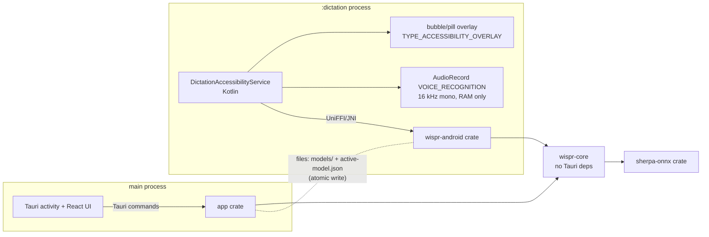

# 0002 — Android dictation architecture

- **Status:** accepted 2026-11-23 (research synthesis; AP-S1/AP-S2 device spikes can amend the mic section)
- **Evidence:** `research/android-platform.md`, `research/tauri-architecture.md`

## Decision

1. **Two processes, one APK.** The AccessibilityService runs in `android:process=":dictation"`. Tauri calls `process::exit(0)` when its last window closes, and tauri#15671 (open; verified 2026-11-23) leaves a blank WebView when another component keeps the process alive.
2. **No Tauri runtime in the dictation path.** Kotlin loads the Rust library directly (`System.loadLibrary`) and calls `wispr-core` through a thin binding crate. Tauri documents this pattern.
3. **Cross-process state goes through files only:** the model directory plus `active-model.json`, written atomically (write to a temp file, then rename). The dictation process reads them at the start of each session. No IPC, binder or broadcast in the MVP.
4. **Overlay:** `TYPE_ACCESSIBILITY_OVERLAY` with `FLAG_NOT_FOCUSABLE`, no `SYSTEM_ALERT_WINDOW`. It sits above the IME layer. Show it only for focused fields that are editable, not password, and not `accessibilityDataSensitive`.
5. **Mic:** `AudioRecord(VOICE_RECOGNITION)` starts only on an explicit tap. Whether a foreground service is needed depends on spikes AP-S1 (try without one) and AP-S2 (start a `microphone` FGS from the tap). The source code suggests the bound service inherits the foreground-mic capability, but no doc confirms it.
6. **Binding choice:** UniFFI proc-macros (generated Kotlin, no hand-written JNI). Ticket P3.1 (with TA-S1/TA-S3) proves that UniFFI and the sherpa-onnx `.so` load together in the Tauri Android build. If it fails, fall back to the `jni` crate with hand-written exports.

## Rejected
- Same-process service: killed by Tauri's exit path (above).
- Tauri IPC from the service: the WebView may not exist.
- `SYSTEM_ALERT_WINDOW` overlay: needs an extra grant, and Android 15's enhanced confirmation mode guards it.
