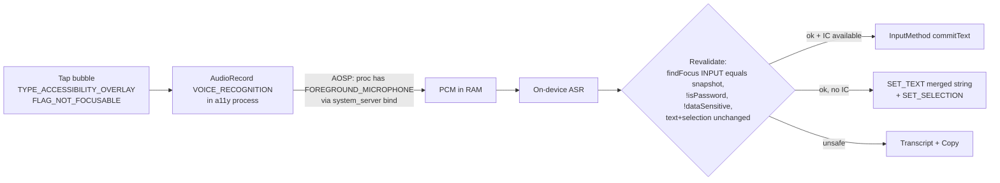

# Android platform research: AccessibilityService dictation bubble

Researched 2026-11-23. Scope: Wispr Free Android MVP. An AccessibilityService shows a mic bubble over a focused editor in another app, records PCM in memory, runs ASR on the device, then revalidates the field and inserts text (or falls back to Copy). The app never sends anything by itself.

Tags:
- **VERIFIED**: read in a primary source this session (developer.android.com, AOSP or Chromium/androidx source, a Google support or policy page).
- **SUPPORTED**: secondary sources only.
- **UNVERIFIED**: my inference.

AOSP links point at `android15-release` unless they say otherwise. The first test device is likely Android 15. Vendor (vivo Funtouch) changes are **not** covered by AOSP. Every AOSP-derived claim still needs the on-device spike at the end of this file.

---

## TL;DR

**Overall view: GO for the MVP design, with two changes.**

1. **Insert through `AccessibilityService.InputMethod` first** (`FLAG_INPUT_METHOD_EDITOR`, API 33+, `commitText` at the cursor). Use `ACTION_SET_TEXT` only as a fallback. It replaces the whole text and moves the cursor to the end.
2. **Treat the microphone FGS as optional.** Decide after the spike. AOSP gives a bound accessibility service's process the microphone capability directly.



Top risks, ranked:

| # | Risk | Severity | Status |
|---|---|---|---|
| 1 | Google Play: a general dictation tool almost certainly **cannot** set `isAccessibilityTool=true`. It needs prominent disclosure, consent and the Play declaration form. Review risk is real. A Play rejection does not block an F-Droid or sideload release. | High (Play only) | VERIFIED policy text |
| 2 | Restricted settings / ECM: an APK installed from a browser or file manager (`PACKAGE_SOURCE_LOCAL_FILE`/`DOWNLOADED_FILE`) cannot be granted accessibility until the user taps "Allow restricted settings". Onboarding must explain this. | High (UX) | VERIFIED AOSP + Google help |
| 3 | Mic capture works because system_server's binding passes capabilities to the accessibility process. That is **AOSP** behaviour. vivo/Funtouch may differ, and vivo may kill background processes. | High until the spike | VERIFIED AOSP, UNVERIFIED on vivo |
| 4 | `ACTION_SET_TEXT` semantics: whole-text replace, cursor at end, spans and undo history lost. Compose reads the argument with `getString`, so passing a `Spannable` **clears the field**. | Medium | VERIFIED source |
| 5 | `getText()` returns the **hint** when a TextView is empty. You must check `isShowingHintText()` or you will splice the hint into the user's text. | Medium | VERIFIED source |
| 6 | Apps can mark views `accessibilityDataSensitive` (API 34). A non-tool service then cannot read or act on them. Banking and password UIs will refuse insertion, which is the correct outcome. | Low (desired) | VERIFIED source |
| 7 | Android 17 Advanced Protection reportedly revokes accessibility access for non-tool services. Android 16 Advanced Protection already blocks sideloading. This only affects at-risk users who opt in. | Low | SUPPORTED (A17), VERIFIED (A16 sideload) |

---

## Q1. Microphone capture from an accessibility overlay tap

### What the docs say about FGS while-in-use

- **VERIFIED**: "if an app wants to launch a foreground service that needs *while-in-use* permissions (for example, … microphone …), it cannot *create* the service while the app is in the background, even if the app falls into one of the exemptions from background start restrictions." Source: https://developer.android.com/develop/background-work/services/fgs/restrictions-bg-start
- **VERIFIED**: On Android 14+, "when you create a foreground service of type microphone, the operating system verifies that your app currently has the RECORD_AUDIO permission. If you don't have that permission, the system throws a SecurityException." Same page, `#wiu-restrictions`.
- **VERIFIED**: The documented while-in-use exemptions are:
  - a system component starts the service
  - app widgets
  - a notification
  - a PendingIntent from a different, visible app
  - device owner
  - `VoiceInteractionService` provider
  - `START_ACTIVITIES_FROM_BACKGROUND`

  **Accessibility services are not on the documented list.** The visible-overlay rule appears only in the *background-start* list, not the while-in-use list. It applies to `SYSTEM_ALERT_WINDOW` holders "with a visible overlay window" on targetSdk 35+, and the A15 change names `TYPE_APPLICATION_OVERLAY`. Sources: same page, and https://developer.android.com/about/versions/15/behavior-changes-15#fgs-sysalert
- **VERIFIED**: Microphone FGS type needs manifest `foregroundServiceType="microphone"`, `FOREGROUND_SERVICE_MICROPHONE`, and a granted `RECORD_AUDIO`. "you cannot create a microphone foreground service while your app is in the background … with a few exceptions". The microphone type has **no** timeout. Only `dataSync`/`mediaProcessing` (6h/24h) and `shortService` (~3 min) have timeouts. Source: https://developer.android.com/develop/background-work/services/fgs/service-types

### What AOSP actually does for a bound accessibility service (undocumented)

- **VERIFIED (AOSP)**: system_server binds accessibility services with:

  ```java
  Context.BIND_AUTO_CREATE | Context.BIND_FOREGROUND_SERVICE_WHILE_AWAKE
      | Context.BIND_ALLOW_BACKGROUND_ACTIVITY_STARTS | Context.BIND_INCLUDE_CAPABILITIES
  ```

  Identical on `android15-release` and `main`. Source: https://android.googlesource.com/platform/frameworks/base/+/refs/heads/android15-release/services/accessibility/java/com/android/server/accessibility/AccessibilityServiceConnection.java (lines ~162-165)
- **VERIFIED (AOSP)**: In `OomAdjuster.computeServiceHostOomAdjLSP`, `if (cr.hasFlag(Context.BIND_INCLUDE_CAPABILITIES)) { capability |= cstate.getCurCapability(); }`. The client here is system_server, which is persistent and gets `setCurCapability(PROCESS_CAPABILITY_ALL)`. Persistent clients map the service to `PROCESS_STATE_BOUND_FOREGROUND_SERVICE` when `BIND_FOREGROUND_SERVICE_WHILE_AWAKE` is set and the device is awake. Source: https://android.googlesource.com/platform/frameworks/base/+/refs/heads/android15-release/services/core/java/com/android/server/am/OomAdjuster.java
- **VERIFIED (AOSP)**: The `RECORD_AUDIO` app-op is gated on `PROCESS_CAPABILITY_FOREGROUND_MICROPHONE` (`AppOpsUidStateTrackerImpl`: `case OP_RECORD_AUDIO: return PROCESS_CAPABILITY_FOREGROUND_MICROPHONE;`). Source: https://android.googlesource.com/platform/frameworks/base/+/refs/heads/android15-release/services/core/java/com/android/server/appop/AppOpsUidStateTrackerImpl.java
- **UNVERIFIED (inference from the three facts above)**: While an accessibility service is enabled and bound and the screen is on, its process should hold the foreground microphone capability. `AudioRecord` should then deliver real audio **with no FGS at all**. The lack of an FGS notification is a privacy-UX question; the green mic privacy indicator should still appear. **Spike test S1.**
- **VERIFIED (AOSP)**: If an FGS is still wanted, `ActiveServices.shouldAllowFgsWhileInUsePermissionLocked` grants WIU when `pr.getWindowProcessController().areBackgroundFgsStartsAllowed()`. The comment says: "The binding flag BIND_ALLOW_BACKGROUND_ACTIVITY_STARTS is also allowed by the check here." That binding flag adds a `BackgroundStartPrivileges.ALLOW_BAL` token to the process (`ServiceRecord.getBackgroundStartPrivilegesWithExclusiveToken`). `ALLOW_BAL = new BackgroundStartPrivileges(true, true, null)`, which "implies allowing foreground service starts". Sources: ActiveServices.java, ServiceRecord.java, `core/java/android/app/BackgroundStartPrivileges.java`, `services/core/java/com/android/server/wm/BackgroundLaunchProcessController.java` (all `android15-release`).
  - **UNVERIFIED**: So in AOSP, starting a `microphone` FGS from the accessibility process on a bubble tap should get reason `REASON_ACTIVITY_STARTER` and **not** throw. Undocumented, so Google may change it and an OEM may patch it. **Spike S2.**
  - Note: `shouldAllowFgsWhileInUsePermissionByBindingsLocked` reads `mAm.getUidStateLocked(callingUid)` where the comment says it checks the *client*. As written it would not help us. Do not rely on that path.

### Concurrent capture (Gboard voice typing, calls, assistants)

- **VERIFIED (doc)**: "'Privileged' apps … These include the Google Assistant, and all accessibility services." For an accessibility service plus an ordinary app: "If the service's UI is on top, both the service and the app receive audio input." During a voice call: "The call always receives audio. The app can capture audio if it is an accessibility service." Silenced capture can be detected with `AudioRecordingConfiguration.isClientSilenced()` via `AudioRecord.registerAudioRecordingCallback()`, which must be registered before `startRecording()`. Source: https://developer.android.com/media/platform/sharing-audio-input
- **VERIFIED (AOSP audio policy)**: `AudioPolicyService::updateUidStates_l()` special-cases accessibility UIDs. The UID list is pushed by `AccessibilityManagerService` through `audioManager.setAccessibilityServiceUids(...)` for bound services. In the policy code:
  - "Clients capturing for Accessibility services … are not considered for top or latest active". So we do not silence the user's other recorder, and vice versa.
  - An accessibility client is allowed if `!isAssistantOnTop && allowSensitiveCapture && canCaptureIfInCallOrCommunication`, **or** if `isA11yOnTop` and the source is `VOICE_RECOGNITION`/`HOTWORD`.
  - `isA11yOnTop()` is true when the accessibility UID's proc state is between `PROCESS_STATE_TOP` and `PROCESS_STATE_BOUND_FOREGROUND_SERVICE`. That is exactly what the bind flags produce while the device is awake.

  Sources: https://android.googlesource.com/platform/frameworks/av/+/refs/heads/android15-release/services/audiopolicy/service/AudioPolicyService.cpp and `AccessibilityManagerService.java` (~line 2804).
  - **Design consequence (UNVERIFIED until S3)**: use `MediaRecorder.AudioSource.VOICE_RECOGNITION`. That should keep capture alive even during a call or while a privacy-sensitive (VoIP) capture is running. Without it, those cases silence us.
- **VERIFIED (doc)**: "if Sensor Privacy is enabled then all recordings should be silenced". The mic quick-settings toggle produces silence, not an error. Detect it and tell the user. Source: AudioPolicyService.cpp `silenceAllRecordings_l`.
- **VERIFIED (doc)**: Android 9+ silent-mic behaviour: "When an app without a foreground service or foreground UI component started to capture, the app continued running but received silence". The silent failure is the risk if vivo does not apply the capability grant. Source: sharing-audio-input page.
- **VERIFIED (doc)**: The runtime `RECORD_AUDIO` grant must happen through our own Activity (a normal permission prompt) before first use. Background `checkSelfPermission` "returns PERMISSION_GRANTED even if the app is in the background". Do not treat that as proof that capture will work. Source: restrictions-bg-start page.

---

## Q2. `TYPE_ACCESSIBILITY_OVERLAY` windows

- **VERIFIED (AOSP javadoc)**: "Windows that are overlaid *only* by a connected AccessibilityService for interception of user interactions without changing the windows an accessibility service can introspect." Source: https://android.googlesource.com/platform/frameworks/base/+/refs/heads/android15-release/core/java/android/view/WindowManager.java (`TYPE_ACCESSIBILITY_OVERLAY = FIRST_SYSTEM_WINDOW+32`)
- **VERIFIED (AOSP)**: **No `SYSTEM_ALERT_WINDOW` needed.** `PhoneWindowManager.checkAddPermission` does not route `TYPE_ACCESSIBILITY_OVERLAY` through the alert-window/SAW branch. It returns `ADD_OKAY`, and a token check is done by WindowManager. A newer flag-gated path tags it with app-op `OP_CREATE_ACCESSIBILITY_OVERLAY`. `AccessibilityService.getSystemService(WINDOW_SERVICE)` sets the connection's window token as the default token: "Set e default token obtained from the connection to ensure client could use accessibility overlay." By contrast, `TYPE_APPLICATION_OVERLAY` "Requires SYSTEM_ALERT_WINDOW permission". Sources: `services/core/java/com/android/server/policy/PhoneWindowManager.java`, `core/java/android/accessibilityservice/AccessibilityService.java`, WindowManager.java.
  - So: call `addView` with the **service** context (or `createWindowContext(TYPE_ACCESSIBILITY_OVERLAY, …)`, which the service overrides to wrap in `AccessibilityContext`). Do not use the Application context.
  - **UNVERIFIED**: Purpose of `OP_CREATE_ACCESSIBILITY_OVERLAY` (behind `createAccessibilityOverlayAppOpEnabled()`). It is probably a new user/admin control over accessibility overlays. Not confirmed for Android 15 builds.
- **VERIFIED (AOSP)**: Z-order from `WindowManagerPolicy.getWindowLayerFromTypeLw`: `TYPE_APPLICATION_OVERLAY` → 11, `TYPE_INPUT_METHOD` → 13, status bar 15, nav bar 24, `TYPE_ACCESSIBILITY_OVERLAY` → **31**. **The bubble draws above the IME**, so it can cover keys. Place it with that in mind, for example above the IME top edge using `AccessibilityWindowInfo.TYPE_INPUT_METHOD` bounds from `getWindows()` (needs `FLAG_RETRIEVE_INTERACTIVE_WINDOWS`). Source: `services/core/java/com/android/server/policy/WindowManagerPolicy.java`.
- **VERIFIED (doc)**: Focus flags:
  - `FLAG_NOT_FOCUSABLE`: "this window won't ever get key input focus … Those will instead go to whatever focusable window is behind it. This flag will also enable FLAG_NOT_TOUCH_MODAL … it will be Z-ordered and positioned independently of any active input method". That keeps the editor focused and its InputConnection alive.
  - `FLAG_NOT_TOUCH_MODAL`: touches outside go to windows behind.
  - `FLAG_WATCH_OUTSIDE_TOUCH`: gives a single `ACTION_OUTSIDE`.

  Source: https://developer.android.com/reference/android/view/WindowManager.LayoutParams
- **Alternative (VERIFIED)**: `attachAccessibilityOverlayToWindow(int accessibilityWindowId, SurfaceControl sc)` / `attachAccessibilityOverlayToDisplay(...)`. These use `SurfaceControlViewHost`. A window-attached overlay "will maintain the same relative position within the window bounds as the window moves". The API level was **not confirmed** this session (believed API 34; UNVERIFIED). This is more complex than a plain View, so it is not the MVP choice. Source: AccessibilityService.java javadoc.
- **Dragging (UNVERIFIED, standard practice)**: `OnTouchListener` on the bubble, then `WindowManager.updateViewLayout(view, lp)` with new `x`/`y` (`gravity = TOP|START`, `WRAP_CONTENT`). Use a touch-slop threshold to tell a tap from a drag. No platform restriction was found.

---

## Q3. Text insertion and revalidation

### Action semantics

- **VERIFIED (AOSP javadoc)**: `ACTION_SET_TEXT`: "Action that sets the text of the node. Performing the action without argument, using null or empty CharSequence will clear the text. This action will also put the cursor at the end of text." **It replaces the whole text.**
- **VERIFIED**: `ACTION_SET_SELECTION`: "Performing this action with no arguments clears the selection." Arguments are `ACTION_ARGUMENT_SELECTION_START_INT`/`_END_INT`.
- **VERIFIED**: `ACTION_PASTE`: "Action to paste the current clipboard content." It is clipboard-based, which the design rules out.

Source for all three: https://android.googlesource.com/platform/frameworks/base/+/refs/heads/android15-release/core/java/android/view/accessibility/AccessibilityNodeInfo.java

- **VERIFIED (TextView impl)**:
  - `SET_TEXT` returns false unless `isEnabled()` and the buffer type is `EDITABLE`. It then calls `setText(text)` and `Selection.setSelection(mSpannable, len)`. The **existing spans and formatting are discarded**.
  - `ACTION_PASTE` requires `isFocused() && canPaste()`.

  Source: `core/java/android/widget/TextView.java` (`performAccessibilityActionInternal`).
- **VERIFIED (getters)**:
  - `getTextSelectionStart()`: "the cursor location if there is no selection, or -1 if there is no text selection and no cursor".
  - `isShowingHintText()`: "whether the node's text represents a hint".
  - `getHintText()`.
  - `isPassword()`, `isEditable()`.
  - `refresh()`: "false if the View … is no longer in the view tree".
  - `getViewIdResourceName()`: needs `FLAG_REPORT_VIEW_IDS`, "primary usage … UI test automation".
  - `getUniqueId()`: app-set, so unreliable.
  - `getSourceNodeId()` is `@hide`. **Do not use it.**
  - Public `equals()` compares `mSourceNodeId` and `mWindowId`. **This is the supported "same node" test.**

  Source: AccessibilityNodeInfo.java.
- **VERIFIED (TextView)**: When the field is empty, `getText()` returns the **hint**: `getTextForAccessibility(): if (TextUtils.isEmpty(mText)) return mHint;`, with `info.setShowingHintText(isShowingHint())`. For password fields, `getText` returns the *transformed* text (dots). Text is also `trimToParcelableSize`'d, so very long text may be truncated. Splicing into truncated text would corrupt it. Refuse when `text.length` hits the cap (UNVERIFIED exact cap).
- **VERIFIED (View, API 34)**: `setAccessibilityDataSensitive` means "only allow interactions from AccessibilityServices with the isAccessibilityTool property set to true". Views default to sensitive when `filterTouchesWhenObscured` is set, and children inherit it. Source: `core/java/android/view/View.java`. **Never set `isAccessibilityTool` falsely to get around this.**

### Preferred path: the accessibility InputMethod (API 33+)

- **VERIFIED**: `android.accessibilityservice.InputMethod` was "Added in API level 33". It needs `AccessibilityServiceInfo.FLAG_INPUT_METHOD_EDITOR` ("makes the AccessibilityService an input method editor with a subset of input method editor capabilities: get the InputConnection and get text selection change notifications").
  - Override `onCreateInputMethod()`.
  - `getInputMethod().getCurrentInputConnection()` returns `AccessibilityInputConnection` with `commitText(CharSequence, int newCursorPosition, TextAttribute)`, `setSelection`, `getSurroundingText`, `deleteSurroundingText`, `sendKeyEvent`, `performEditorAction`.
  - `getCurrentInputEditorInfo()` exposes `inputType`, so a password variant can be refused even when the node info lies.

  Sources: https://developer.android.com/reference/android/accessibilityservice/InputMethod and `core/java/android/accessibilityservice/InputMethod.java`, `AccessibilityServiceInfo.java`.
  - **Why prefer it (UNVERIFIED)**: `commitText` inserts at the cursor through the same path a keyboard uses. Spans stay, the app's undo and TextWatcher semantics stay, and WebView/Compose editors get the text through their normal InputConnection. The user's keyboard stays selected. AOSP `InputMethodManagerService` creates accessibility IME sessions alongside the real IME. No password filter was found in IMMS, so **we must filter ourselves.** **Spike S5.**
  - Do not call `performEditorAction` or `sendKeyEvent(ENTER)`. That keeps the never-auto-send rule.

### Fallback path: `SET_TEXT`

Snapshot `text`, `selStart` and `selEnd` at record start. At insert time:
1. `refresh()` the node.
2. Re-check everything.
3. Build `before + transcript + after`.
4. `SET_TEXT` it as a **plain `String`**.
5. `SET_SELECTION` to `selStart + transcript.length`.

- **VERIFIED (androidx Compose source)**: Compose reads the argument with `arguments?.getString(ACTION_ARGUMENT_SET_TEXT_CHARSEQUENCE)`, and `BaseBundle.getString` returns `null` on `ClassCastException`. Compose then invokes `SetText(AnnotatedString(text ?: ""))`. **A non-String CharSequence clears the field.** Compose exposes `ACTION_SET_TEXT` only if `SemanticsActions.SetText` is present and the node is enabled. It always adds `ACTION_SET_SELECTION` for non-empty text, and adds `ACTION_PASTE` only when focused and the clipboard has text. Compose sets `hintText` from semantics. **Not checked**: whether Compose sets `showingHintText` (no reference found in the delegate, UNVERIFIED). Source: https://github.com/androidx/androidx/blob/androidx-main/compose/ui/ui/src/androidMain/kotlin/androidx/compose/ui/platform/AndroidComposeViewAccessibilityDelegateCompat.android.kt
- **VERIFIED (Chromium source)**: Chrome/WebView `ACTION_SET_TEXT` returns false unless `isEditableText`. It then calls `setTextFieldValue(newText)` and moves the cursor to the end ("Match Android framework"). It supports `ACTION_SET_SELECTION`. `ACTION_PASTE` calls `WebContents.paste()`. **Not verified**: how `setTextFieldValue` behaves on `contenteditable` (rich editors such as Gmail web or Docs). Formatting loss and framework-state desync (React-controlled inputs) are likely. Source: https://chromium.googlesource.com/chromium/src/+/refs/heads/main/content/public/android/java/src/org/chromium/content/browser/accessibility/WebContentsAccessibilityImpl.java
- **UNVERIFIED**: Custom editors (WhatsApp, Gmail's native composer) may ignore `SET_TEXT`, or accept it and then revert it. After any insert, re-read `getText()` and confirm the transcript landed. If it did not, fall back to Copy.

### "Same field" check (recommended, UNVERIFIED composite)

Take a snapshot when recording starts:
- `findFocus(FOCUS_INPUT)` node
- `windowId`
- `packageName`
- `className`
- `viewIdResourceName`
- `text`/`selStart`/`selEnd`
- `isShowingHintText`

At insert time, all of these must hold:
- `refresh()` is true.
- A fresh `findFocus(FOCUS_INPUT)` returns a node that `equals()` the snapshot (same source id and window id).
- `isEditable && !isPassword && !isAccessibilityDataSensitive`.
- The EditorInfo inputType is not a password variant.
- Text and selection are unchanged, or the transcript is anchored with `getSurroundingText`.

Caveat: recycled list views can reuse a node with the same id and different content. The text-equality check covers that. Note from the javadoc: `findFocus` fails for views embedded via `SurfaceView#setChildSurfacePackage`.

---

## Q4. Restricted settings (Android 13+) and Enhanced Confirmation Mode (Android 15)

- **VERIFIED (AOSP, A13-14 path)**: `InstallPackageHelper` sets `OP_ACCESS_RESTRICTED_SETTINGS = MODE_ERRORED` only when `request.getPackageSource()` is `PACKAGE_SOURCE_LOCAL_FILE` or `PACKAGE_SOURCE_DOWNLOADED_FILE`. Source: https://android.googlesource.com/platform/frameworks/base/+/refs/heads/android15-release/services/core/java/com/android/server/pm/InstallPackageHelper.java
- **VERIFIED (AOSP, A15 ECM path, flag-gated)**: With `enhancedConfirmationModeApisEnabled && extendEcmToAllSettings`, the guard is decided lazily by `EnhancedConfirmationService.isPackageEcmGuarded`:
  - Pre-installed or allow-listed apps are not guarded.
  - `LOCAL_FILE`/`DOWNLOADED_FILE` sources are guarded.
  - Otherwise, an app is guarded only if trusted-installer entries exist and the installer is neither pre-installed nor allow-listed. AOSP's `data/etc/enhanced-confirmation.xml` is an empty `<config></config>`, so with no entries "we treat all installers as trusted".
  - `PROTECTED_SETTINGS` includes `OPSTR_BIND_ACCESSIBILITY_SERVICE` **and `OPSTR_SYSTEM_ALERT_WINDOW`**. This is another reason to avoid SAW.
  - `main` adds restrictions while an untrusted call is ongoing.

  Sources: https://android.googlesource.com/platform/packages/modules/Permission/+/refs/heads/android15-release/service/java/com/android/ecm/EnhancedConfirmationService.java and `frameworks/base/data/etc/enhanced-confirmation.xml`.
- **What this means by install path** (UNVERIFIED, inferred from the code above):

  | Install path | Package source set by | Guarded? |
  |---|---|---|
  | Browser download or file manager through the system Package Installer | Installer sets LOCAL/DOWNLOADED | **Yes**, needs "Allow restricted settings" |
  | `adb install` | Unspecified | No (AOSP) |
  | F-Droid client / Obtainium (session API) | Whatever they pass in `SessionParams.setPackageSource` | No, unless they pass LOCAL/DOWNLOADED, or the OEM ships trusted-installer entries. **Not verified per client.** |
  | vivo's own installer / app store | OEM | **Unknown. Spike S6.** |

- **VERIFIED (Google help)**: To allow it: "open the Settings app" → "Tap **Apps**" → tap the app → tap the More icon → "Allow restricted settings" → "Follow the on-screen instructions." Source: https://support.google.com/android/answer/12623953. AOSP `clearRestriction` only succeeds from state `GUARDED_AND_ACKNOWLEDGED`. The user must first try to enable the service and see the block dialog, then the menu item works (VERIFIED from ECM code).
- **SUPPORTED**: "the CDD mandates that all devices running Android 15 enable restricted settings by default". Source: https://www.androidauthority.com/android-15-restricted-settings-sideloading-3481098 (secondary; CDD not read).

---

## Q5. Google Play Accessibility API policy

Source: https://support.google.com/googleplay/android-developer/answer/10964491 (VERIFIED via fetch; page text may be truncated)

- "Only services that are designed to help people with disabilities access their device" qualify for `isAccessibilityTool`. "The tools must support people with disabilities as their primary purpose."
- A qualifying example is "Voice-based input systems which support people with motor impairments". A non-qualifying example is "A general assistant that is voice-activated … that targets a large user population". Also non-qualifying: "antivirus software, automation tools, assistants".
- Non-tool apps "must meet the prominent disclosure and consent requirements". The disclosure must be "within the app itself, cannot only be in the app description or on a website". Consent must "require affirmative user action". It "Cannot be included with other disclosures pertaining to personal or sensitive data collection". The developer "will be required to complete an accessibility declaration in Play Console."
- The policy also prohibits using the API to "autonomously initiate, plan, and execute actions", with a carve-out for "deterministic, rule-based automation". The never-auto-send design fits.
- **UNVERIFIED verdict**: A general dictation tool is *permissible* as a non-tool with disclosure, consent and the declaration. It is **not** eligible for `isAccessibilityTool=true` unless positioned and built primarily for motor-impaired users. A false flag risks suspension and also misrepresents the app to `accessibilityDataSensitive` views. Play also requires a microphone FGS-type declaration if we use one (VERIFIED: service-types page, "declare your app's foreground service types in the Play Console").
- `isAccessibilityTool` meaning (VERIFIED, AOSP `AccessibilityServiceInfo`): "Indicates if the service is used to assist users with disabilities." It is read from the `android:isAccessibilityTool` meta-data attribute.

---

## Q6. Android 15/16/17 changes that matter

- **A15 (VERIFIED)**:
  - The SAW FGS-start exemption now needs a visible `TYPE_APPLICATION_OVERLAY`.
  - Audio focus requires top-app or FGS.
  - `BOOT_COMPLETED` cannot start microphone FGS.
  - "Block non-visible windows from being considered for background activity launches".

  Source: https://developer.android.com/about/versions/15/behavior-changes-15
- **A14 (VERIFIED)**: FGS types are mandatory, and while-in-use is checked at FGS creation with a `SecurityException`. `accessibilityDataSensitive` was added (View.java).
- **A16 (VERIFIED)**:
  - Advanced Protection Mode (opt-in) includes "Blocked app sideloading" (https://developer.android.com/privacy-and-security/advanced-protection-mode).
  - The behaviour-change pages list no accessibility-service or microphone-FGS change for normal mode (https://developer.android.com/about/versions/16/behavior-changes-all, `/behavior-changes-16`).
  - Job quota changes are irrelevant.
- **A17 (VERIFIED)**:
  - "Background audio hardening" covers playback, focus and volume when the app is not in a valid lifecycle. For targetSdk 37, background audio needs an FGS with WIU capabilities. The page talks about playback, focus and volume. **Whether it touches *capture* was not stated** (UNVERIFIED). Details: https://developer.android.com/about/versions/17/changes/bg-audio (not read).
  - BAL hardening extends to `IntentSender`.
  - Sources: https://developer.android.com/about/versions/17/behavior-changes-all, `/behavior-changes-17`
- **A17 Advanced Protection and accessibility (SUPPORTED)**: Non-`isAccessibilityTool` services are blocked or revoked when AAPM is on. Sources: https://www.androidauthority.com/android-17-beta-2-advanced-protection-mode-accessibility-apps-3648860, https://thehackernews.com/2026/10/android-17-advanced-protection-locks.html. No developer.android.com page found.

---

## Needs an on-device spike (iQOO Neo 10R, Funtouch OS)

Prep:
- `adb shell getprop ro.build.version.release`
- `adb shell getprop ro.vivo.os.version`

Build a throwaway debug APK with:
- an accessibility service (`canRetrieveWindowContent`, `FLAG_RETRIEVE_INTERACTIVE_WINDOWS`, `FLAG_REPORT_VIEW_IDS`, `FLAG_INPUT_METHOD_EDITOR`)
- a bubble overlay
- an `AudioRecord` RMS meter
- a log screen

| ID | Question | Steps | Pass criterion |
|---|---|---|---|
| S1 | Mic works with no FGS? | Grant RECORD_AUDIO in our Activity, then leave it. Open WhatsApp and tap the bubble. Record 5 s with `VOICE_RECOGNITION`. Log RMS and `isClientSilenced()`. Also run `adb shell dumpsys activity processes <pkg>` (procstate/caps) and `adb shell dumpsys audio` / `dumpsys media.audio_policy` (record clients). | Non-zero RMS, not silenced, capability includes mic (`M`/`FOREGROUND_MICROPHONE`) |
| S2 | Mic FGS start allowed from the a11y process? | Same as S1, but call `startForegroundService` plus `startForeground(..., FOREGROUND_SERVICE_TYPE_MICROPHONE)` on tap. Run `adb logcat -s ActivityManager` and look for "Foreground service started from background can not have … microphone access". | No exception and no log line |
| S3 | Concurrency | (a) Start Gboard or vivo keyboard voice typing, then our bubble. (b) During a real phone call. (c) During a WhatsApp voice call. (d) Mic privacy toggle OFF. | Record which side gets silence. (d) must be detected and shown to the user. |
| S4 | Screen-off / background kill | Record for 60 s, lock the screen mid-way, then unlock. Leave the device idle for 30 min and check the service is still bound (`dumpsys accessibility`). Repeat with vivo battery optimisation on and off. | Capture survives, or fails detectably. Service not silently killed. |
| S5 | Insert via `InputMethod.commitText` | Test in WhatsApp chat, Gmail compose (to/subject/body), Chrome URL bar, Chrome `<textarea>` and `contenteditable` page, a Compose sample TextField, and a vivo Settings search box. Put the cursor mid-text, then commit. | Text inserted at cursor, formatting kept, nothing sent. Log `getCurrentInputConnection()==null` cases. |
| S6 | `SET_TEXT` fallback | Same fields. Merged String plus `SET_SELECTION`. Re-read `getText()`. Include an empty field (hint) and a field with bold or mention spans. | Hint never spliced in. Record span loss. Detect silent reverts. |
| S7 | Overlay | Bubble with `FLAG_NOT_FOCUSABLE` over a focused field with the keyboard up. Tap and drag. | IME stays up, editor keeps focus, bubble above IME and draggable. No SAW prompt. |
| S8 | Restricted settings / ECM | Install via (a) Chrome download → Files → vivo installer, (b) `adb install`, (c) F-Droid client (debug repo), (d) Obtainium. For each, try enabling the service. Check `adb shell appops get <pkg> ACCESS_RESTRICTED_SETTINGS` and `adb shell dumpsys package <pkg> \| grep -i packageSource`. | Record which paths are blocked and the exact vivo menu path to "Allow restricted settings". |
| S9 | Sensitive fields | Password field, a banking app, a field with `filterTouchesWhenObscured`. | `isPassword` / `isAccessibilityDataSensitive` / EditorInfo password detected, and we refuse insertion. |
