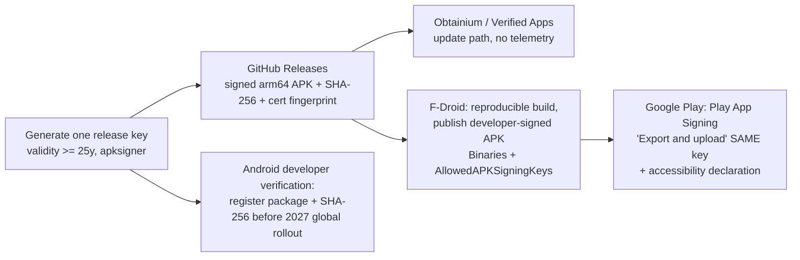

# Distribution, licensing and test-device research: Wispr Free

Researched 2026-11-23. Scope: release path (GitHub, then F-Droid/IzzyOnDroid, then Play, desktop later), licensing for a GPL-3.0 Tauri v2 + Kotlin app using sherpa-onnx, runtime model downloads, the iQOO Neo 10R test device, and the trademark facts.

**Evidence labels**
- **VERIFIED**: read in a primary source this session (vendor or official docs, the license file itself, the store's own policy, or the fdroiddata recipe).
- **SUPPORTED**: secondary sources only (news, aggregators, forum posts by staff or users).
- **UNVERIFIED**: inference or unconfirmed. Check it before relying on it.

None of this is legal advice. The licence sections record what the texts say. Where an interpretation is needed, it is marked.

---

## TL;DR

**Recommended release path**

1. **One key everywhere.** Sign the GitHub APK with your own key. Later, give F-Droid the same key through reproducible builds that publish the developer signature, and upload that same key to Play App Signing. Users can then move between channels without reinstalling.
2. **F-Droid over IzzyOnDroid.** IzzyOnDroid's policy rejects "vibe-coded" apps and says app code "should be free of" LLM-generated text. This project is built through agent TDD handoffs, so that policy is a likely blocker (VERIFIED policy text; whether it applies here is the user's call). It also caps apps at about 30 MB. F-Droid has no adopted ban on AI-written code, and Tauri apps are already in fdroiddata.
3. **Play last.** Play needs an in-app prominent disclosure for the AccessibilityService, a Play Console declaration, 16 KB-aligned native libraries (updates blocked after 2027-02-01), and it is the strictest venue on name confusion.

**Top risks (ranked)**

| # | Risk | Impact | Mitigation |
|---|---|---|---|
| 1 | vivo/OriginOS kills the app or switches the accessibility service off (reported "within 5 hours or less") | Core feature silently dies | Onboarding checklist below. Detect the service is disabled and show a re-enable prompt. Test on the device. |
| 2 | Android 13+ **Restricted settings**: a sideloaded APK can't have its accessibility service turned on until the user picks "Allow restricted settings" | First-run blocker for GitHub APK users | Onboarding step with a deep link to App info |
| 3 | IzzyOnDroid AI policy (agent-written code) | Rejection | Target F-Droid. Be transparent if applying anyway. |
| 4 | Model licences: Parakeet is CC-BY-4.0 (attribution and modification notice). **Moonshine non-English legacy models are NON-COMMERCIAL.** | Licence breach or F-Droid anti-feature | Allow-list models by licence. Show attribution in the model picker and the About screen. |
| 5 | F-Droid **NonFreeNet** anti-feature for downloading models from Hugging Face (precedent: Whisper, SherpaTTS) | Warning label, not a rejection | Accept it, or mirror models on GitHub Releases (whether that avoids the label is unverified) |
| 6 | Android developer verification goes global in 2027 | Unregistered sideloads need the "advanced flow" | Register the package name and SHA-256 fingerprint in the Android Developer Console |
| 7 | "Wispr Free" vs "Wispr Flow": Play policy covers confusingly similar trademarks, and F-Droid needs trademark permissions | Possible store takedown | Facts recorded in section 5. The user has accepted this risk. |

---

## 1. iQOO Neo 10R

| Fact | Value | Status / source |
|---|---|---|
| SoC | Qualcomm Snapdragon 8s Gen 3 | VERIFIED: iQOO India spec page https://www.iqoo.com/in/products/param/neo10r |
| RAM | 8 GB / 12 GB | VERIFIED (same page; exact RAM+storage pairings not stated there) |
| Storage | 128 GB / 256 GB | VERIFIED (same page). UFS 4.1 vs 3.1 conflicts between sources: SUPPORTED/conflicting (Digit/GSMArena say 4.1; an iQOO community post says 3.1) |
| Shipped OS | Funtouch OS 15, Android 15 | VERIFIED (iQOO spec page) |
| Launch | India, 11 March 2025 | SUPPORTED: https://www.gizchina.com/2025/03/11/iqoo-neo-10r-launched-in-india-with-sd-8s-gen-3-and-6400-mah-battery/ |
| Update promise | 3 Android upgrades (16 to 18) + 4 years of security patches | SUPPORTED: Notebookcheck https://www.notebookcheck.net/iQOO-Neo-10R-launches-with-Snapdragon-8s-Gen-3-chipset-and-a-large-6-400-mAh-battery.976829.0.html (not on the iQOO spec page) |
| **Moved to OriginOS** | **Yes.** OriginOS 6 (Android 16) beta late Nov 2025, stable from about 18 Dec 2025. Monthly OriginOS 6 builds followed through at least May 2026. | SUPPORTED: iQOO community posts https://community.iqoo.com/in/thread/128759, https://community.iqoo.com/in/thread/151572 ; Gizmochina 2025-12-18 (403 on fetch) |
| OriginOS 7 (Android 17) | Neo 10R listed for "mid-December" India rollout; no exact date | SUPPORTED: Digit https://www.digit.in/news/general/iqoo-originos-7-update-rollout-timeline-in-india-eligible-smartphones-and-more-details.html |
| ABI | arm64-v8a | UNVERIFIED for this unit (expected for this SoC). Check with `adb shell getprop ro.product.cpu.abilist`. |
| 16 KB page size | Unknown | UNVERIFIED. Check with `adb shell getconf PAGE_SIZE` (16384 means 16 KB) per https://developer.android.com/guide/practices/page-sizes |

**Implication:** the test device will most likely run **OriginOS 6, not Funtouch OS**. The settings paths below come from Funtouch-era docs, so confirm each one on the device. Build 16 KB-aligned anyway (see §6).

---

## 2. vivo / Funtouch / OriginOS background behaviour

**What breaks**
- vivo kills background apps to manage power. dontkillmyapp lists **no known developer-side fix**, and says vivo's restrictions "have not been fully documented". VERIFIED: https://dontkillmyapp.com/vivo
- **The accessibility switch turns itself off.** vivo's own FAQ, "Why is the accessibility switch of the app always turned off automatically?", gives no cause. Its fix: add the app to the **Speedup whitelist**, turn on **High background power consumption**, allow **Autostart**, and turn on all permission options. VERIFIED (vivo PH support): https://www.vivoglobal.ph/?p=4006
- One vendor reports that "certain Vivo and OnePlus devices" introduced (2024) "system-level changes that automatically disable accessibility services after a limited period, typically within 5 hours or less", and that this "cannot be overridden or fixed from within the app". SUPPORTED (third-party vendor): https://skedit.zendesk.com/hc/en-us/articles/7951680906908-Accessibility-Limitation-on-Vivo-OnePlus-Devices
- Android 13+ **Restricted settings**: apps installed by a non-session installer (a browser download, a file manager) can't get Accessibility or Notification Listener access until the user allows it under **Settings > Apps > [app] > ⋮ > Allow restricted settings**. VERIFIED (steps): https://support.google.com/android/answer/12623953 . The session-installer exemption and the Android 15 expansion (to overlays and more) are SUPPORTED: https://www.androidauthority.com/android-15-restricted-settings-sideloading-3481098 , https://gitlab.com/fdroid/fdroidclient/-/issues/2680
- Overlay (`SYSTEM_ALERT_WINDOW`): on Android 15 sideloaded apps may also hit restricted settings for draw-over-apps. SUPPORTED (Android Authority above).

**User-facing whitelist steps (dontkillmyapp vivo, VERIFIED text; menu names vary by version)**
1. Autostart: *Settings > More settings > Applications > Autostart*, turn on the app (older: *i Manager > App manager > Autostart manager*).
2. Battery usage: *Settings > Apps > [app] > Battery*, set to **Unrestricted** (Android 13+).
3. *Settings > Battery > Background power consumption management*, allow the app.
4. *Settings > Battery > High background power consumption*, enable the app.
5. Battery optimisation: long-press the icon > App info > Battery > Battery optimisation > **Not optimised**.
6. Lock in recents: open Recents, then the app's menu or swipe down, then **Lock**.

**How FOSS accessibility apps handle onboarding (precedent)**
- **Key Mapper** (GPL-3.0, on F-Droid) sends users to dontkillmyapp.com at first setup, and prompts again "when the accessibility service crashes". It shows a battery-optimisation dialog warning that the OEM may have more killers. It can grant itself `WRITE_SECURE_SETTINGS` (via Shizuku, root or ADB) so it can restart its own accessibility service. VERIFIED in the repo: `CHANGELOG.md`, `base/src/main/res/values/strings.xml` (`url_dont_kill_my_app`, `slide_description_read_dont_kill_my_app`) at https://github.com/keymapperorg/KeyMapper
- Pattern worth copying: an onboarding slide per OEM setting, a "service disabled" check on every app open, and an optional ADB/Shizuku `WRITE_SECURE_SETTINGS` path for power users. Whether that path survives vivo's auto-disable is UNVERIFIED.

---

## 3. F-Droid and IzzyOnDroid

### F-Droid requirements
- "The complete application building process requires a 100% FLOSS toolchain". "All binary dependencies including JAR files must originate either from source compilation or Debian repository downloads". Prebuilts are allowed only "from authorized trusted sources". VERIFIED: https://f-droid.org/docs/Inclusion_Policy/
- Apps "must not download additional executable binary files" without opt-in consent. Model weights are data, not executables. Inference: this rule doesn't apply to models (UNVERIFIED). Same source.
- "All assets need to have valid legal licenses". "Applications need to obtain necessary trademark and copyright permissions". VERIFIED, same source.
- **Rust/Tauri in fdroiddata: precedents exist.** VERIFIED via the GitHub mirror of fdroiddata: `metadata/page.tine.app.yml` (Tine, a Tauri app) uses `sudo: apt-get install … rustup`, then `rustup default 1.96.0`, `rustup target add aarch64-linux-android`, `npm ci`, `tauri android build --target aarch64 --apk`, `ndk: 26.3.11579264`. Other Tauri recipes: `org.opengrind.yml`, `com.nooto.app.yml`, `com.bosun.app.yml`. A `srclibs/rustup.yml` exists. https://github.com/f-droid/fdroiddata
- **Prebuilt sherpa-onnx:** fdroidserver's scanner allow-lists Maven repos including `jitpack.io` and Maven Central. VERIFIED: `fdroidserver/scanner.py` `allowed_repos` https://gitlab.com/fdroid/fdroidserver/-/raw/master/fdroidserver/scanner.py . **SherpaTTS (on F-Droid, GPL-3.0) depends on `com.github.k2-fsa:sherpa-onnx:v1.13.0` from JitPack** (VERIFIED: woheller69/ttsengine `app/build.gradle.kts` + `settings.gradle.kts`). sherpa-onnx's `jitpack.yml` just `wget`s the **prebuilt AAR from GitHub Releases** and re-publishes it (VERIFIED: k2-fsa/sherpa-onnx `jitpack.yml`, v2.0.3). So F-Droid has accepted a prebuilt sherpa-onnx + ONNX Runtime AAR at least once. That is precedent, not policy: a stricter reviewer could still ask for a source build (UNVERIFIED). A Tauri app linking sherpa-onnx from Rust (via the C API) likely needs the native `.so` some other way than an AAR (UNVERIFIED; design decision).
- **Reproducible builds:** F-Droid can publish the **developer-signed APK** if its rebuild matches ("Publishing only takes place if there is a proper match"). It uses the `Binaries` field and `AllowedAPKSigningKeys`, either developer-signed only or both. Sign with apksigner. **Build-tools ≥ 35.0.0-rc1 produce APKs apksigcopier can't verify, so apksigner 34 is recommended for now.** VERIFIED: https://f-droid.org/docs/Reproducible_Builds/

### Anti-features that apply (VERIFIED definitions: https://f-droid.org/docs/Anti-Features/)

| Anti-feature | Definition (short) | Triggered? |
|---|---|---|
| **NonFreeNet** | Promotes or depends entirely on a non-free network service | **Likely, if models come from Hugging Face.** Precedent: Whisper (`org.woheller69.whisper`, "download the Whisper models from Hugging Face") and SherpaTTS (`NonFreeNet: Download voice model from Hugging Face`). VERIFIED: https://f-droid.org/packages/org.woheller69.whisper/ , https://f-droid.org/packages/org.woheller69.ttsengine/ , fdroiddata `metadata/org.woheller69.ttsengine.yml`. Counter-example: **Sayboard** (Vosk models, built-in downloader) shows **no** anti-feature (VERIFIED: https://f-droid.org/packages/com.elishaazaria.sayboard/). Whether GitHub-hosted models avoid the label: UNVERIFIED. |
| **NonFreeAssets** | Non-free media, e.g. CC with NC or ND clauses | Only if an NC model is offered (e.g. Moonshine Community License models). Applying it to model weights is an inference (UNVERIFIED). |
| **Tracking** | Tracking or reporting "without your permission or by default", including update checks done without your knowledge | **Yes, if an update check or model-catalogue fetch runs by default without consent.** Make it opt-in or disclosed. |
| TetheredNet | Depends entirely on a hard-to-replace service | Avoid by allowing a custom model URL or a local import (Sayboard pattern) |
| NonFreeDep | Needs non-free software to run | No |
| KnownVuln | Flagged by fdroidserver scanners | Keep ONNX Runtime and others current |

### IzzyOnDroid (VERIFIED: https://izzyondroid.org/docs/general/AppInclusionPolicy/)
- Accepts **developer-built, developer-signed release APKs** from GitHub, GitLab or Forgejo releases. No debuggable or testOnly flags.
- **About 30 MB per app**, which is also the single-APK cap ("larger apps may be exceptions"). Keeps up to 3 versions.
- FOSS licence approved by OSI or FSF. No trackers. The same opt-in rule applies to downloading executables.
- Reproducible builds are not required, but are "preferred".
- **AI policy:** "Vibe-coded apps will be rejected." LLM front-ends are rejected. Docs may contain LLM text, "the code itself should be free of it". LLM use for research or debugging is fine. "Any lack of transparency… can lead to the project being degraded to rejected state."

### Generative-AI policies elsewhere
- F-Droid: a draft interim policy (modelled on Debian's) "neither endorses nor prohibits" generative AI. Adoption is unconfirmed. Issue #641 proposes an AI anti-feature; no decision seen. SUPPORTED/UNVERIFIED: https://gitlab.com/fdroid/admin/-/issues/699 , https://gitlab.com/fdroid/admin/-/issues/641
- **Flathub** (relevant for later desktop builds): submitters must disclose AI-generated material, manifests "must not contain AI-generated or AI-assisted content", and AI agents must not open submission PRs. VERIFIED: https://docs.flathub.org/docs/for-app-authors/requirements

---

## 4. Licensing

### Component licences

| Component | Licence | Status |
|---|---|---|
| sherpa-onnx | Apache-2.0 | VERIFIED: GitHub licence API → https://github.com/k2-fsa/sherpa-onnx/blob/master/LICENSE |
| ONNX Runtime | MIT | SUPPORTED: the README says MIT; packagers (FreshPorts, MSYS2) list MIT. The GitHub API returned 404 for microsoft/onnxruntime this session, so the LICENSE file was not read. |
| Tauri | MIT **or** Apache-2.0 (dual) | VERIFIED: tauri-apps/tauri README badge + `LICENSE-APACHE-2.0` |
| Whisper code **and weights** | MIT | VERIFIED: openai/whisper README "Whisper's code and model weights are released under the MIT License"; HF `openai/whisper-large-v3-turbo` card license `mit` |
| Parakeet TDT 0.6B v2 / v3 | CC-BY-4.0 | VERIFIED: HF API `nvidia/parakeet-tdt-0.6b-v2`, `-v3` → `cc-by-4.0`; the sherpa-onnx int8 conversion `csukuangfj/sherpa-onnx-nemo-parakeet-tdt-0.6b-v2-int8` is also `cc-by-4.0` with base_model nvidia |
| Moonshine | **Mixed.** MIT by default (all streaming models, English Tiny/Base). **Non-commercial "Moonshine AI Community License"** for legacy non-streaming Arabic, Japanese, Korean, Mandarin, Spanish (Base), Ukrainian and Vietnamese models. TTS/G2P data carry their own terms. | VERIFIED: https://github.com/moonshine-ai/moonshine/blob/main/LICENSE |

### GPL-3.0 compatibility (FSF / ASF)
- Apache-2.0: "compatible with version 3 of the GNU GPL" (not GPLv2). VERIFIED: https://www.gnu.org/licenses/license-list.html . ASF: "Apache 2 software can therefore be included in GPLv3 projects", not the reverse. VERIFIED: https://www.apache.org/licenses/GPL-compatibility.html
- Expat/MIT: "compatible with the GNU GPL" (both v2 and v3 unless stated). VERIFIED: gnu.org license list.
- CC BY 4.0: "compatible with all versions of the GNU GPL", though not recommended for software. VERIFIED: gnu.org license list.
- So the whole stack can ship under GPL-3.0. Use `GPL-3.0-or-later` or `-only` consistently. The Apache-2.0 §4 duties remain: ship the licence text, keep NOTICE files (e.g. any sherpa-onnx or ONNX Runtime NOTICE), and mark modified files. The Apache NOTICE requirement is from the licence text itself, which was not re-read this session (SUPPORTED).

### Model weights downloaded at runtime (not bundled)
- CC-BY-4.0 §3(a), whenever you "Share" the material: keep the creator identification, the copyright notice, a notice that refers to the licence, a notice that refers to the warranty disclaimer, and a URI to the material "to the extent reasonably practicable". **Indicate if You modified** it, and keep earlier modification notices. All of this may be done "in any reasonable manner based on the medium, means, and context". VERIFIED: https://creativecommons.org/licenses/by/4.0/legalcode.en
- Interpretation (UNVERIFIED, not legal advice): if the app downloads weights straight from a third-party host, the host is the one sharing. The app's duty is weaker, but showing the attribution costs nothing and covers the case where you mirror models on GitHub Releases (then **you** share them). The sherpa-onnx int8/ONNX conversions are modifications of NVIDIA's model, so name both NVIDIA and the conversion.
- Never offer Moonshine Community-License models as default. If they're offered at all, gate them behind an explicit "non-commercial licence" notice. They would also trigger F-Droid NonFreeAssets, and probably break the user's own commercial use (UNVERIFIED that F-Droid would apply the label).

### Third-party licences / NOTICE screen: required contents
1. App licence (GPL-3.0) with a link to the source and the exact commit or tag.
2. Each bundled native or JS/Rust dependency: name, version, licence, copyright line, full licence text (Apache-2.0, MIT). Include Apache NOTICE file contents verbatim. Generate them, don't hand-write: e.g. `cargo about` / `cargo-license` for crates and the Gradle licence plugin for Kotlin (choosing a tool is a new dependency, so ask first).
3. Per downloaded model, shown **in the model picker and in About**: model name, creator (e.g. "NVIDIA"), copyright notice if one exists, licence name + link (CC BY 4.0 / MIT), source URL (HF repo), "Converted to ONNX/int8 by k2-fsa/sherpa-onnx (modified)", and a warranty disclaimer reference.
4. MIT models (Whisper, Moonshine-MIT): the copyright + permission notice "shall be included in all copies or substantial portions". Store the LICENSE next to the downloaded weights and show it.

---

## 5. Trademark facts (no advice; risk recorded factually)

Decision on record: the user keeps the name "Wispr Free".

| Mark | Owner | Serial | Status | Source / status |
|---|---|---|---|---|
| WISPR (Class 9) | Wispr AI, Inc. | 97072209 | Dead: abandoned for no statement of use (Jul 2024) | SUPPORTED: markinton aggregator via search |
| FLOW (AI speech recognition software) | Wispr AI | 98681053 (filed 2024-08-03) | Reported dead | SUPPORTED: Justia / markinton via search |
| FLOW VOICE | Wispr AI | 98681059 | Reported dead | SUPPORTED |
| LANGUAGE USER INTERFACE, NEURAL MICROPHONE, DIGITAL THOUGHT, INTENTION TO ACTION | Wispr AI, Inc. | 98059467, 98580605, 98191613, 98057194 | Not shown as registered | SUPPORTED |
| WISPR FLOW | Haijing He (not Wispr AI) | 99560508 | Pending | SUPPORTED |
| WISPR (Class 10) | Wisc Med, LLC | 88206646 | Registered 2020-05-19 | SUPPORTED |

- USPTO TSDR could not be read: the API now needs a key, and the web UI needs JavaScript. **No Wispr AI registration was confirmed.** WIPO/EUIPO/Indian registry were not searched. UNVERIFIED overall.
- Wispr AI, Inc.'s terms say its services are "protected by copyright, trade secret, trademark and other US and foreign laws". Unregistered (common-law) rights may still exist. VERIFIED: https://wisprflow.ai/terms
- Google Play: "We don't allow apps that infringe on others' trademarks", where infringement is the "use of an identical or similar trademark in a way that is likely to cause confusion as to the source". VERIFIED: https://support.google.com/googleplay/android-developer/answer/9888072 . The Impersonation policy bans titles or icons "so similar to those of existing products or services that users may be misled". VERIFIED: https://support.google.com/googleplay/android-developer/answer/9888374
- F-Droid: "Applications need to obtain necessary trademark and copyright permissions." VERIFIED: Inclusion Policy.

---

## 6. Release mechanics

**Signing**
- Updates install only when the certificates match. A different key means a different package name. Key validity should be **≥ 25 years**, and Play needs validity ending after **22 Oct 2033**. A lost self-managed key means no more updates. VERIFIED: https://developer.android.com/studio/publish/app-signing
- Play App Signing is **required for new apps**. "If you want to use the same signing key across multiple stores, make sure to provide your own signing key… instead of having Google generate one". Use **Change app signing key > Export and upload**, then register a separate **upload key**. VERIFIED: same page + https://support.google.com/googleplay/android-developer/answer/9842756 . New AAB apps default to Google-generated keys, so you **must change this before the first open or production release**.
- Get the SHA-256 cert fingerprint with `apksigner verify --print-certs app.apk` or `keytool -list -v -keystore …`; the Play Console App signing page shows MD5/SHA-1/SHA-256. VERIFIED (Play Console part); the apksigner and keytool commands are standard, not re-read this session (SUPPORTED).
- For F-Droid reproducible builds, sign with **apksigner from build-tools 34** (see §3).

**Android developer verification** (VERIFIED: https://developer.android.com/developer-verification , FAQ https://developer.android.com/developer-verification/guides/faq.md.txt , OSS guide https://developer.android.com/developer-verification/guides/open-source-app-registration.md.txt)
- Enforcement since **2026-09-30** covers participating stores in Brazil, Indonesia, Singapore and Thailand only. **Global rollout in 2027** on certified devices running Android 8+. Sideloads and other stores aren't enforced "yet".
- Register the package name + **SHA-256 signing cert fingerprint** in the Android Developer Console (full account US$25 + ID) or the Play Console. Limited-distribution accounts are free with no ID, but limited to **20 devices**. Multiple keys per package are allowed. If a repository re-signs the APK (an F-Droid-signed build), add that key too. Using one developer key everywhere avoids this.
- ADB installs are exempt, which covers the iQOO dev loop. Unregistered apps need the user's one-time "advanced flow" (developer mode, restart, 24 h wait, biometric).

**Publishing integrity data per release**
- APK SHA-256. GitHub now exposes per-asset `digest: sha256:…` in the releases API (VERIFIED by reading Obtainium's latest release via `gh api`). Also put it in the release notes or a `SHA256SUMS` file.
- Signing-cert SHA-256 fingerprint in the README and release notes, the way Obtainium's README does. VERIFIED: https://github.com/ImranR98/Obtainium
- Optional: register in the Privacy Guides "Verified Apps" list (Obtainium recommends it). SUPPORTED.

**Updates without telemetry**
- Obtainium installs and updates from GitHub/GitLab/Forgejo/F-Droid/IzzyOnDroid release pages, so the app needs **no update code**. VERIFIED: Obtainium README.
- Any in-app "check GitHub Releases" must be **off by default or clearly disclosed**, or F-Droid applies **Tracking** (definition cites update checks done without consent). VERIFIED: Anti-Features page.

**Play-specific**
- **AccessibilityService:** apps that aren't accessibility tools need an in-app prominent disclosure with affirmative consent, separate from other data disclosures. The `AccessibilityService_description` doesn't count. A Play Console declaration is needed for targetSdk ≥ 31. `isAccessibilityTool` is only for tools whose primary purpose is helping people with disabilities. VERIFIED: https://support.google.com/googleplay/android-developer/answer/10964491
- **16 KB pages:** targetSdk 35+ apps must support 16 KB on 64-bit devices, and updates that don't are blocked from **2027-02-01**. NDK r28+ aligns by default, and AGP ≥ 8.5.1 handles zip alignment. **Prebuilt `.so` files (sherpa-onnx, ONNX Runtime) must be 16 KB-aligned too.** Check with `zipalign -c -P 16 -v 4 app.apk` or `check_elf_alignment.sh`. VERIFIED: https://developer.android.com/guide/practices/page-sizes . The F-Droid Tauri precedent uses NDK 26.3, which needs `-Wl,-z,max-page-size=16384`.

---

## iQOO Neo 10R onboarding checklist

Cover each screen in onboarding: one slide per item, each with an "Open settings" intent where one exists. Re-run the checks on every app open. Paths are from Funtouch-era docs, so **confirm on OriginOS 6 and record the actual paths here.**

- [ ] **Firmware:** note the OS (OriginOS 6 / Android 16?), build, `getconf PAGE_SIZE`, `ro.product.cpu.abilist`.
- [ ] **Install path:** if the APK came from a browser or file manager, App info > ⋮ > **Allow restricted settings** before the accessibility toggle (Android 13+; Google help 12623953).
- [ ] **Accessibility:** Settings > (More settings) > Accessibility > Installed services > Wispr Free > On.
- [ ] **Display over other apps** (overlay): App info > Display over other apps > Allow. On Android 15 this may also need "Allow restricted settings".
- [ ] **Microphone** runtime permission. **Notifications** permission (Android 13+) if a foreground-service notification is used.
- [ ] **Autostart:** Settings > More settings > Applications > Autostart > Wispr Free on.
- [ ] **Battery: Unrestricted:** App info > Battery > Unrestricted. Also Battery optimisation > Not optimised (`ACTION_REQUEST_IGNORE_BATTERY_OPTIMIZATIONS` needs a Play-policy justification; for sideload builds use `ACTION_IGNORE_BATTERY_OPTIMIZATION_SETTINGS`).
- [ ] **Background power consumption management / High background power consumption:** Settings > Battery > … > allow Wispr Free.
- [ ] **Speedup whitelist** (vivo FAQ term; find the OriginOS equivalent, likely under iManager / phone-manager cleanup).
- [ ] **Lock in Recents:** Recents > app menu or swipe down > Lock.
- [ ] **Soak test:** enable everything, leave the phone idle 6+ hours and through a reboot. Check whether the accessibility toggle survives (the ≤5 h auto-disable claim). Log the results in `blockers/` if it fails.
- [ ] **Detection:** the app checks `Settings.Secure.ENABLED_ACCESSIBILITY_SERVICES` on start and shows a re-enable prompt. Link https://dontkillmyapp.com/vivo (Key Mapper pattern).
- [ ] **Optional power-user path:** `adb shell pm grant <pkg> android.permission.WRITE_SECURE_SETTINGS` so the app can re-enable its own service (Key Mapper pattern). Whether that works against vivo's auto-disable is UNVERIFIED.

---

## Open / unverified items
- ONNX Runtime LICENSE file not read directly (GitHub returned 404 this session).
- USPTO status of every Wispr mark (TSDR needs an API key). WIPO and Indian registry not searched.
- Neo 10R ABI list, page size, current OriginOS build and exact OriginOS 6 settings paths.
- Whether F-Droid would accept a prebuilt sherpa-onnx `.so` for a Rust/Tauri link, or ask for a source build.
- Whether GitHub-hosted models avoid NonFreeNet.
- Whether F-Droid's interim generative-AI policy was adopted.
