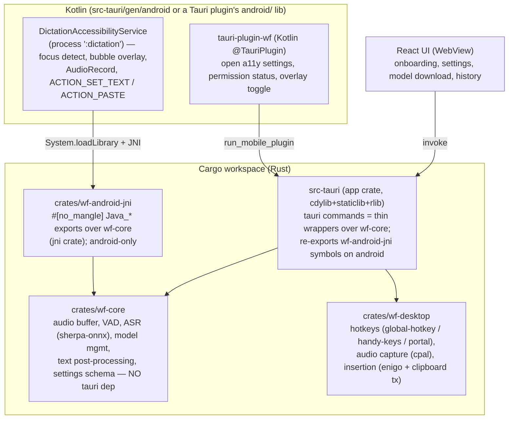

# Tauri v2 architecture research — Wispr Free

Researched 2026-11-23. Evidence labels:
- **VERIFIED**: read in a primary source this session (docs page, upstream source at a stated commit, crate tarball, or a binary inspected locally).
- **SUPPORTED**: secondary source only (forum, issue reporter, vendor marketing, search summary).
- **UNVERIFIED**: inference or memory, not checked this session.

Source snapshots: `tauri-apps/tauri` @ `003fcd99` (2026-11-23), `tauri-apps/wry` @ `ebef3cda` (2026-11-23), `cjpais/Handy` @ `939c9573` (2026-11-21), `sherpa-onnx-sys` 2.0.3 crate tarball, `sherpa-onnx-v2.0.3-android.tar.bz2` release asset.

---

## TL;DR

- **Android is feasible on Tauri v2, but the dictation path should not depend on Tauri.** Tauri starts its runtime only when the activity is first created. A Kotlin `AccessibilityService` can `System.loadLibrary("<app>_lib")` and call plain JNI exports in the same Rust cdylib, and the Tauri docs list this pattern. Run the service in a **separate process** (`android:process=":dictation"`). A process that outlives its activity breaks Tauri today (open issue #15671), and Tauri's exit-on-last-window-close calls `process::exit(0)`, which would kill a co-hosted service.
- **sherpa-onnx is ready for this.** The official `sherpa-onnx` crate (Apache-2.0) has Tauri-Android support built in: its build script copies `libsherpa-onnx-c-api.so` and `libonnxruntime.so` into `gen/android/app/src/main/jniLibs/<abi>`. The prebuilt arm64 `.so` files are already 16 KB aligned, link libc++ statically (no `libc++_shared.so`), and are about 27 MB uncompressed.
- **iOS verdict: no for parity, maybe later as a separate keyboard app.** iOS has no API for inserting into or overlaying other apps. The only route is a custom keyboard extension, which Apple documents as having no microphone access and which runs under a per-process memory limit. It would be a Swift extension that links the Rust core, not Tauri. Wispr Flow works around the limit through its containing app ("Flow Sessions"), and that grey area is getting tighter on iOS 26.4+. Defer it.

### Recommended module / crate layout



| Layer | Owns | Platforms |
|---|---|---|
| `wf-core` (Rust) | ASR session API (`start`, `push_pcm`, `finish -> String`), model files, text cleanup, settings types | all |
| `wf-android-jni` (Rust) | stable C-ABI/JNI surface for the service; no Tauri types | Android |
| Kotlin service (+ small Tauri plugin) | Accessibility events, overlay window, mic capture (or pass PCM to Rust), text insertion, FGS/notification | Android |
| React | settings/onboarding/history only; never on the dictation hot path | all |
| `wf-desktop` (Rust) | hotkey, capture, insertion, clipboard save/restore | Win/macOS/Linux |

Design rule: **the hot path (bubble tap → audio → text inserted) must not need the WebView or the Tauri runtime.** Desktop can use Tauri for the floating window and tray. Insertion and hotkeys stay in plain Rust, so they can be tested without a window.

### Top risks

1. **Process-lifetime clash (Android).** Tauri assumes the process dies with the activity: #15671 is OPEN and #11609 was closed with the scenario still broken. Mitigation: a separate `:dictation` process for the service. Cost: the model can load in two processes, and settings move over files or a ContentProvider/Binder instead of shared memory.
2. **Starting the microphone from the background (Android 14+).** A `microphone` FGS cannot be *created* while the app is in the background. The documented exemption list does not name AccessibilityService. Whether a TYPE_ACCESSIBILITY_OVERLAY bubble tap counts as "visible" or user-initiated is UNVERIFIED and needs a spike.
3. **Google Play AccessibilityService policy and APK size.** Non-accessibility-tool use of the AccessibilityService API gets extra review (UNVERIFIED this session). F-Droid / direct APK is the safer first channel. The native libraries are about 27 MB plus Rust plus models.
4. **Linux Wayland insertion and hotkeys.** `global-hotkey` (behind `tauri-plugin-global-shortcut`) is X11-only. Insertion on Wayland depends on the compositor (wtype / dotool / ydotool / portal). Handy documents the same pain.
5. **Clipboard-paste correctness.** A fixed restore delay can race the target app's paste. Handy's "receipt-sequenced" paste (Windows delayed rendering, macOS lazy pasteboard) is the reference design.

---

## Q1. Tauri v2 Android: layout, Kotlin plugins, services, calling Rust without the WebView

### Project layout (VERIFIED, tauri @003fcd99 `crates/tauri-cli/templates/mobile/android/`)
- `tauri android init` creates `src-tauri/gen/android/`, a normal Gradle project: `app/build.gradle.kts`, `app/src/main/AndroidManifest.xml`, `app/src/main/MainActivity.kt`, `buildSrc/src/main/kotlin/{RustPlugin.kt,BuildTask.kt}`, plus `tauri.build.gradle.kts` (generated and applied by `app/build.gradle.kts`).
- `MainActivity : TauriActivity()`. `TauriActivity : WryActivity()` (generated from `crates/tauri/mobile/android-codegen/TauriActivity.kt`) forwards lifecycle calls to `PluginManager`.
- Template values: `compileSdk = 37`, `targetSdk = 37`, `minSdk = {{android.min-sdk-version}}`. Release builds have `optimization { enable = true }` (R8) with every `**/*.pro` as ProGuard rules.
- `RustPlugin.kt` creates the product flavors `universal` and one per arch (`abiFilters`), and hooks `rustBuild<Arch><Profile>` tasks before `merge*JniLibFolders`. That is how the Rust `.so` gets into `jniLibs`.
- The manifest template has one `.MainActivity` (singleTask) and a FileProvider. The app owns `gen/android`, and it is meant to be committed and edited (signing docs tell you to edit `app/build.gradle.kts`, see Q2).

### Writing a Kotlin mobile plugin (VERIFIED, https://v2.tauri.app/develop/plugins/develop-mobile/)
- A Kotlin class extends `app.tauri.plugin.Plugin` and is annotated `@TauriPlugin`. Methods annotated `@Command` take `invoke: Invoke` and "can be called by Rust or JavaScript". Lifecycle hooks are `load(webView)` and `onNewIntent(intent)`. Events go out through `trigger("name", payload)` and are received in JS with `addPluginListener`.
- Commands are "scheduled on the main thread". Use `CoroutineScope(Dispatchers.IO)` for blocking work.
- Runtime permissions are declared in `@TauriPlugin(permissions = [Permission(strings=[...], alias=...)])`, and `checkPermissions` / `requestPermissions` are generated for you.
- Rust → Kotlin: `PluginHandle::run_mobile_plugin("cmd", payload)`. The plugin build uses `tauri_plugin::Builder::android_path("android")` (VERIFIED, `crates/tauri-plugin/src/build/mod.rs:124`), which copies `tauri-api` into `android/.tauri/` and emits `cargo:android_library_path`.

### Declaring an AccessibilityService and other Services
- **App level (VERIFIED, template):** `gen/android/app/src/main/AndroidManifest.xml` is a normal, editable manifest, so `<service android:name=".DictationAccessibilityService" android:permission="android.permission.BIND_ACCESSIBILITY_SERVICE">` plus `res/xml/accessibility_service_config.xml` and Kotlin under `app/src/main/java/...` all work. Nothing in Tauri blocks it.
- **Plugin level (VERIFIED):** the plugin template ships `android/src/main/AndroidManifest.xml` (an empty `<manifest>`), i.e. an Android *library* manifest. Library manifests are merged into the app by AGP's manifest merger (standard Android behaviour, UNVERIFIED this session). Tauri also exposes `tauri_plugin::mobile::update_android_manifest(block_identifier, parent, insert)` for build-script injection into the app manifest (VERIFIED, `crates/tauri-plugin/src/build/mobile.rs:99`).
- **Recommendation:** put the service in a local Tauri plugin (`plugins/tauri-plugin-wf/android/`). Its manifest declares the `<service>`, the accessibility XML resource and the FGS permissions. The Kotlin then stays out of `gen/android`, which gets regenerated.

### Can Kotlin call the app's Rust without the WebView or Tauri runtime? Yes
- **Documented (VERIFIED, develop-mobile page):** add `jni = "0.21"` for `cfg(target_os="android")`, then in Kotlin `System.loadLibrary("app_lib")` with `external fun helloWorld(name: String): String?`, and in Rust `#[no_mangle] pub extern "system" fn Java_com_example_HelloWorld_helloWorld(...)`. The page says JNI "allows plugins to call shared code, even when the application WebView is suspended."
- **Why the Tauri runtime does not start (VERIFIED, source):**
  - wry `src/android/kotlin/Rust.kt`: `object Rust { init { System.loadLibrary("{{library}}") } ... external fun onFirstActivityCreate() ... }`. The library is loaded lazily, the first time `WryActivity` touches `Rust`.
  - tauri-macros `mobile.rs`: `#[tauri::mobile_entry_point]` on Android expands to `android_binding!(..., _start_app, ::tauri::wry)`, and `_start_app` runs the user's `run()` (Builder) only when tao calls it from the first activity's create. `start_app` as an `extern "C"` export exists only on non-Android targets.
  - No `JNI_OnLoad` is defined in tauri or wry Android sources (a grep came back empty). Loading the `.so` from a Service therefore runs no Tauri code, only static initialisers, and the service can call its own `Java_*` exports.
- **No UniFFI support in Tauri.** Not mentioned in the docs. UniFFI would work as an ordinary dependency (UNVERIFIED). For about five functions, hand-written `jni` exports are smaller. Use UniFFI only if the surface grows.

### Concrete proposed design
1. `wf-core` exposes a tiny sync API: `Engine::load(model_dir)`, `Session::push_pcm(&[i16])`, `Session::finish() -> String`.
2. `wf-android-jni` exports `Java_app_wisprfree_dictation_NativeAsr_{load,begin,push,finish,release}`. Handles are `jlong` boxes. Every export is wrapped in `catch_unwind`, because a panic across FFI aborts.
3. `src-tauri` lib crate (`crate-type = ["staticlib","cdylib","rlib"]`, name `wisprfree_lib`) depends on `wf-android-jni` under `cfg(target_os="android")` so the symbols end up in the same `.so` Tauri already packages. Mark the symbols `#[used]`/`pub` so LTO keeps them (Spike S3).
4. `DictationAccessibilityService` is declared with `android:process=":dictation"`. It calls `System.loadLibrary("wisprfree_lib")` in its own process, captures with `AudioRecord` (or Oboe in Rust), shows a `TYPE_ACCESSIBILITY_OVERLAY` bubble, and inserts with `AccessibilityNodeInfo.ACTION_SET_TEXT` or `ACTION_PASTE` (API names UNVERIFIED this session).
5. The Tauri UI process only handles settings and models. Shared state lives in files under `filesDir`, or in a `ContentProvider` if live updates are needed. The UI process never hosts the service, so #15671 and Tauri's `process::exit(0)` on last-window-close cannot hurt dictation.

**Risks of this design**
- The cdylib loaded in `:dictation` also contains all of Tauri, wry and tao: more memory, but no code runs. The alternative is a second, slim cdylib (`libwf_asr.so`) built by its own cargo/Gradle task. That is cleaner but sits outside Tauri's `RustPlugin`. Decide in Spike S3.
- If the service shares the UI process instead, you need `RunEvent::ExitRequested → api.prevent_exit()`, and you hit #15671 (a blank WebView on relaunch while a service keeps the process alive). VERIFIED from the issue body; still OPEN at tauri 2.11.5, tao 0.35.3, wry 0.55.1.
- R8 is on in release, so the `external fun` classes need `-keep` rules, or JNI lookup fails at runtime (UNVERIFIED for this template, standard Android).

---

## Q2. Tauri v2 mobile maturity, Android limits, signed arm64 APK

### Release history (VERIFIED, GitHub releases API on tauri-apps/tauri)
- `tauri-v2.0.0` 2024-10-02 (first stable, with iOS and Android support).
- Minor releases: 2.1 (2024-11-09), 2.2 (2025-01-02), 2.3 (2025-02-26), 2.4 (2025-03-20), 2.5 (2025-04-15), 2.6 (2025-06-24), 2.7 (2025-07-20), 2.8 (2025-08-18), 2.9 (2025-10-20), 2.10 (2026-02-02), 2.11 (2026-04-30), 2.12 (2026-09-26). The latest release tag is `tauri-cli-v2.12.6`, 2026-11-18.

### Android limits and issues that matter here
| Item | Finding | Label / source |
|---|---|---|
| Min SDK | "minimum supported Android version for Tauri apps is Android 7.0 (SDK 24)". Raise it with `bundle.android.minSdkVersion` | VERIFIED https://v2.tauri.app/distribute/google-play/ |
| Process outlives activity (FGS or service) | Blank WebView after a swipe-away and relaunch; the root cause is the tao one-activity-one-window id plus resume events being dropped with zero windows; exit-on-last-window calls `std::process::exit(0)` | VERIFIED issue body https://github.com/tauri-apps/tauri/issues/15671 (OPEN, 2026-07-07); history in #11609 (closed 2025-07-28) |
| Services / AccessibilityService | No Tauri docs or API. You use plain Android plus JNI | VERIFIED (absent from develop-mobile page; issue search found nothing) |
| Overlay windows | No Tauri API on Android. The overlay is a native Kotlin `WindowManager` view, not a Tauri window | VERIFIED (no API in plugin docs); design inference |
| Widgets / app extensions | No first-class support; #9766 closed with "Better to look at this into a plugin" | VERIFIED https://github.com/tauri-apps/tauri/issues/9766 |
| Command threading | Kotlin `@Command`s run on the main thread, so there is an ANR risk | VERIFIED develop-mobile page |
| ABI splits | Default is all four ABIs. `--target aarch64` narrows it; `--split-per-abi` gives per-ABI outputs ("only useful for testing or distribution outside Google Play") | VERIFIED google-play page; flavors in `RustPlugin.kt` |
| 16 KB pages | Maintainers: Tauri and official plugins support 16 KB "out of the box with a recent enough ndk"; one reporter needed `build.rs` link args, and a later commenter confirmed NDK 28.2 alone fixed it | VERIFIED comments on https://github.com/tauri-apps/tauri/issues/14895 (closed 2026-02-28) |
| APK size | No official figure. The ASR natives alone are about 27 MB uncompressed for arm64 (see Q3) | VERIFIED local inspection |

### Signed release APK, arm64-v8a only (VERIFIED, https://v2.tauri.app/distribute/sign/android/ + google-play page)
```bash
keytool -genkey -v -keystore ~/upload-keystore.jks -keyalg RSA -keysize 2048 -validity 10000 -alias upload
# src-tauri/gen/android/keystore.properties  (gitignored): password=… keyAlias=upload storeFile=/abs/path/upload-keystore.jks
# src-tauri/gen/android/app/build.gradle.kts:
#   import java.io.FileInputStream
#   signingConfigs { create("release") { /* load keystore.properties → keyAlias, keyPassword, storeFile, storePassword */ } }
#   buildTypes { getByName("release") { signingConfig = signingConfigs.getByName("release") } }
pnpm tauri android build --apk --target aarch64            # universal flavor, arm64 only
pnpm tauri android build --apk --target aarch64 --split-per-abi   # arm64 flavor output
```
- In CI, generate `keystore.properties` from secrets and store the keystore base64-encoded (the docs say this).
- versionCode defaults to `major*1000000 + minor*1000 + patch`; override it with `bundle.android.versionCode`.

---

## Q3. Rust on Android: toolchain, linking sherpa-onnx / ONNX Runtime, pitfalls

### Toolchain (VERIFIED, tauri-cli source)
- Tauri does **not** use cargo-ndk. `tauri-cli` drives builds through `cargo-mobile2` 0.23 (`crates/tauri-cli/Cargo.toml:39`), and Gradle's `BuildTask` calls back into the CLI per target. NDK discovery uses `NDK_HOME` or the SDK `ndk/` directory (`crates/tauri-cli/src/mobile/android/mod.rs:716-806`). Rust targets: `aarch64-linux-android` (plus armv7, i686 and x86_64 if needed).

### Linking sherpa-onnx (VERIFIED, `sherpa-onnx-sys` 2.0.3 build.rs + release tarball)
- Use the official `sherpa-onnx` crate 2.0.3 (Apache-2.0, k2-fsa, updated 2026-11-22), which wraps `sherpa-onnx-sys`. The third-party `sherpa-rs` 0.6.8 (MIT, last release 2025-10-05) is older.
- `resolve_link_mode`: Android and iOS **only support shared** linking. Android links `dylib=sherpa-onnx-c-api` and `dylib=onnxruntime`.
- `copy_to_tauri_android_jnilibs()`: the build script finds the Tauri project and copies the `.so` files into `gen/android/app/src/main/jniLibs/<abi>/` (only if `tauri android init` has run), with a `.sherpa-onnx-version` stamp. So Gradle packages them with no extra wiring.
- Prebuilts are downloaded from GitHub releases at build time. Set `SHERPA_ONNX_LIB_DIR` to vendor them instead (needed for reproducible, offline or F-Droid builds).
- Inspected `sherpa-onnx-v2.0.3-android.tar.bz2` → `jniLibs/arm64-v8a/`:

| file | size | LOAD align | NEEDED |
|---|---|---|---|
| libonnxruntime.so | 22.2 MB | 0x4000 (16 KB) | libdl, liblog, libm, libc |
| libsherpa-onnx-c-api.so | 5.1 MB | 0x4000 | libandroid, liblog, libonnxruntime, libm, libdl, libc |
| libsherpa-onnx-jni.so | 5.4 MB | 0x4000 | (not needed when calling from Rust) |

  So there is **no `libc++_shared.so` dependency**: the sherpa build script passes no `ANDROID_STL`, so the CMake default `c++_static` applies (VERIFIED: `build-android-arm64-v8a.sh` has no STL flag; NEEDED lists confirm it).

### Pitfalls
- **libc++_shared:** if another native dependency (e.g. Oboe through `cpal`, or a C++ crate built with `c++_shared`) brings in `libc++_shared.so`, you must ship exactly one copy, and mixing it with static-libc++ libraries risks ODR / exception-handling bugs. NDK guidance says one STL per app (UNVERIFIED this session, from the NDK C++ support page). Check with `readelf -d` on every `.so` in the APK.
- **16 KB pages (VERIFIED https://developer.android.com/guide/practices/page-sizes):** apps targeting API 35+ must support 16 KB on 64-bit devices for Google Play, and "Starting February 1, 2027 … you won't be able to release these updates" if they don't. NDK r28+ aligns to 16 KB by default. AGP ≥ 8.5.1 is needed for 16 KB zip alignment of uncompressed libraries. Prebuilt `.so` files must be rebuilt too. Older NDKs need `-Wl,-z,max-page-size=16384 -Wl,-z,common-page-size=16384`. Check with `zipalign -c -P 16 -v 4 app.apk` and `llvm-readelf -Wl` (also check the RELRO end alignment). The sherpa prebuilts pass the LOAD check; the RELRO check is not done yet (Spike S4).
- **Tauri overriding `.cargo/config.toml` rustflags:** claimed by one reporter, contradicted by a maintainer (SUPPORTED/disputed, #14895). If needed, emit link args from `build.rs` (`cargo:rustc-link-arg=…`).
- **Models are not native libraries:** ship them as downloads into `filesDir`, not as APK assets, to keep the APK small and avoid copying out of assets.

---

## Q4. Desktop: hotkeys, text insertion, permissions, clipboard

### Hotkeys
- `tauri-plugin-global-shortcut` 2.4.1: platform table Linux ✓ / Windows ✓ / macOS ✓ / Android ✗ / iOS ✗. It depends on `global-hotkey = "0.8"` on desktop only (VERIFIED, plugins-workspace `plugins/global-shortcut/{README.md,Cargo.toml}`).
- `global-hotkey` (0.10.0, 2026-11-09): "Linux (X11 Only)". On Windows the event loop must be on the registering thread; on macOS it must be the main thread (VERIFIED README). The changelog through 0.10 shows no Wayland work (VERIFIED).
- It cannot do **push-to-talk key-up** reliably with modifier-only or `fn` keys. Handy moved to `handy-keys` (MIT, 0.3.5, its own low-level hook crate) for this (VERIFIED, `src-tauri/src/shortcut/handy_keys.rs` header).
- **Windows `RegisterHotKey`** (VERIFIED https://learn.microsoft.com/en-us/windows/win32/api/winuser/nf-winuser-registerhotkey): it fails if the combination is already registered; F12 is reserved; `MOD_NOREPEAT` suppresses auto-repeat. Handy's README: with a low-level hook (handy-keys), "the shortcut also won't work while an administrator app is focused" (VERIFIED README).
- **Wayland:** use the `org.freedesktop.portal.GlobalShortcuts` portal: `CreateSession`, `BindShortcuts` (the app suggests `preferred_trigger`, the user confirms in a dialog, and binding works once per session), and `Activated` / `Deactivated` signals (giving press and release, so push-to-talk works); version 2 adds `ConfigureShortcuts` (VERIFIED https://flatpak.github.io/xdg-desktop-portal/docs/doc-org.freedesktop.portal.GlobalShortcuts.html). Compositor support varies (UNVERIFIED which ones). Fallback (Handy's approach): a CLI flag or Unix signal (`--toggle-transcription`) that the user binds in their compositor (VERIFIED Handy README).

### Text insertion options
| Approach | Pros | Cons |
|---|---|---|
| Synthesized typing (`enigo.text()`) | clipboard untouched | slow for long text; layout and IME issues; macOS `CGEventKeyboardSetUnicodeString` can be ignored ("application frameworks may ignore the Unicode string", VERIFIED Apple docs); Wayland support experimental |
| Clipboard + paste chord (Ctrl/Cmd+V, Shift+Insert) | fast, Unicode-safe, works in most apps | must save and restore the clipboard; races; terminals need a different chord |
| Linux tools: `wtype` (wlroots virtual-keyboard protocol; not KDE/GNOME), `dotool`/`ydotool` (uinput; needs the `input` group or a daemon), `xdotool` (X11) | work where enigo doesn't | external runtime deps; per-compositor matrix |
| RemoteDesktop portal `NotifyKeyboardKeysym` / `ConnectToEIS` (libei) | sanctioned on GNOME/KDE Wayland | needs a user consent dialog (`Start()` "will typically result in the portal presenting a dialog"); restore token is single-use (VERIFIED portal docs) |

- **enigo** 0.6.1 (MIT): X11, macOS and Windows text are stable; Wayland and libei text are "Experimental" behind feature flags (VERIFIED README). Permissions doc: "Linux: no elevated privileges"; Windows is UIPI-limited; macOS needs Accessibility (VERIFIED `Permissions.md`).
- **Windows UIPI** (VERIFIED SendInput docs): "Applications are permitted to inject input only into applications that are at an equal or lesser integrity level", and "neither GetLastError nor the return value will indicate the failure was caused by UIPI". So detect elevated foreground windows yourself and fall back (Handy shows an error and keeps the text in History).
- **macOS TCC:**
  - Posting synthetic events needs Accessibility trust (`AXIsProcessTrustedWithOptions` with `kAXTrustedCheckOptionPrompt`; VERIFIED Apple docs).
  - A global key listener (event tap or IOHID) needs **Input Monitoring**. `CGPreflightListenEventAccess` / `CGRequestPostEventAccess` exist, but Apple's pages have no body text (title-only; SUPPORTED by usage, e.g. `tauri-plugin-macos-permissions` in Handy).
  - The microphone needs `NSMicrophoneUsageDescription` ("required if your app uses APIs that access the device's microphone", VERIFIED).
- **Preserving the clipboard: use clipboard-paste with a receipt-gated restore.** Handy's `paste_tx` (VERIFIED, `src-tauri/src/paste_tx/mod.rs`):
  - Windows: delayed rendering, `SetClipboardData(CF_UNICODETEXT, NULL)`, then wait for `WM_RENDERFORMAT`.
  - macOS: `declareTypes:owner:` with a lazy `provideDataForType:`.
  - Only receipts *after* the injected chord count. Restore only while we still own the clipboard (sequence number / changeCount unchanged), after a quiet period, with a bounded timeout. The failure mode is "the transcript stays on the clipboard longer", never "stale content gets pasted".
  - Linux: a fixed delay (default raised from 60 ms to 500 ms). It sets both CLIPBOARD and PRIMARY and pastes with Shift+Insert so terminals work.
  - Typing (`enigo.text`) is the only method that never touches the clipboard. Offer it as an option, not the default.

---

## Q5. iOS feasibility — verdict

- **Insert into or overlay other apps:** no public API. Apps are sandboxed, and iOS has no AccessibilityService or overlay-window equivalent (UNVERIFIED as a single Apple statement; it follows from the extension model). The only documented route into another app's text field is a **custom keyboard extension** with `textDocumentProxy.insertText` (UNVERIFIED API name this session).
- **Microphone in a keyboard extension:** the App Extension Programming Guide (archived, updated 2017-10-19) says "Custom keyboards, like all app extensions in iOS 8.0, have no access to the device microphone, so dictation input is not possible" (VERIFIED https://developer.apple.com/library/archive/documentation/General/Conceptual/ExtensibilityPG/CustomKeyboard.html). The current page *Configuring open access* lists "No access to microphone and speaker" among the restrictions when open access is off, and does not list the microphone among the open-access capabilities (VERIFIED https://developer.apple.com/documentation/uikit/configuring-open-access-for-a-custom-keyboard). Developers report `CMSUtility_IsAllowedToStartRecording … NOT allowed … because it is an extension` even with Full Access (SUPPORTED https://developer.apple.com/forums/thread/742601).
- **Other limits:**
  - Keyboard extensions run under a memory limit that "var[ies] from model to model" and are terminated when they exceed it (VERIFIED https://developer.apple.com/documentation/uikit/creating-a-custom-keyboard). That is hostile to on-device ASR models.
  - Secure fields and phone pads swap in the system keyboard, and apps can reject custom keyboards (VERIFIED archive guide).
  - App Review 4.4.1: keyboards must "remain functional … without requiring full access" and must not "launch other apps besides Settings" (VERIFIED https://developer.apple.com/app-store/review/guidelines/).
- **How Wispr Flow does it (SUPPORTED, secondary or vendor):**
  - The keyboard hands off to the containing app, which holds the mic open in a time-boxed "Flow Session" (background audio); the keyboard then inserts the returned text. The FAQ says "iOS requires us to bring you back to the Flow app to turn on the mic" (https://9to5mac.com/2025/06/30/wispr-flow-is-an-ai-that-transcribes-what-you-say-right-from-the-iphone-keyboard/, https://en.wikipedia.org/wiki/Wispr_Flow, https://docs.wisprflow.ai/iphone/faq).
  - Its current setup article says "The keyboard records and transcribes on its own, so the Flow app doesn't need to be open", and requires Full Access and mic permission granted in the main app (https://docs.wisprflow.ai/articles/7453988911-set-up-the-flow-keyboard-on-iphone). The mechanism is UNVERIFIED; a page on adapting to iOS 26.4 exists but was not read (session limit).
  - Developers report iOS 26.4 made the handoff harder (host bundle id is nil; `open` without Full Access fails), and DTS answered "No" on a public host-identification API (SUPPORTED https://developer.apple.com/forums/thread/836168, https://developer.apple.com/forums/thread/843118).
  - Wispr Flow also transcribes in the cloud, which sidesteps the memory limit; Wispr Free's on-device model would not.
- **Tauri iOS app extensions:**
  - No first-class support or docs. Developers add extension targets by hand to `gen/apple/project.yml` (XcodeGen) or Xcode: #10074 (a simulator build failure with a share extension, closed). #15663 / PR #16312 (closed 2026-10/11) fixed lost entitlements for embedded `.appex` with API-key signing, which shows extensions are used in practice (VERIFIED issue bodies).
  - A keyboard extension cannot host Tauri or a WebView in a useful way; it would be Swift/UIKit linking `wf-core` as a staticlib (UNVERIFIED feasibility, Spike S7).
- **Verdict:** iOS cannot match the Android or desktop UX. The best case is a keyboard extension plus a containing-app recording session, with real App Review risk under 4.4.1 and an on-device model squeezed by the extension memory limit and app-switch friction. **Not in v1. Revisit only as a separate Swift keyboard target over `wf-core`.**

---

## Q6. Prior art: Handy and others

### Handy — https://github.com/cjpais/Handy (VERIFIED, clone @939c9573)
- **License:** MIT ("Copyright (c) 2025 CJ Pais"). About 39.8k stars, created 2025-02-13, last push 2026-11-21, latest release v0.10.1 (2026-11-14), 30+ contributors (first API page). Very active.
- **Platforms:** Windows, macOS and Linux (README); desktop only, with no Android or iOS code paths (mobile-only deps are cfg-excluded).
- **Architecture (`src-tauri/Cargo.toml`, `src-tauri/src/`):**
  - Tauri 2.11.5 plus a React/TS UI (`src/`), with `tauri-specta` for typed bindings.
  - **ASR:** `transcribe-cpp` 0.4.2 (MIT, handy-computer/transcribe.cpp; GGUF/ggml; Metal on Apple Silicon, Vulkan on Windows x64 and Linux, CPU elsewhere). Older releases used `transcribe-rs` (MIT).
  - **Audio:** `handy-recorder` 0.1.1 (MIT; built on a `handy-cpal` fork, rubato and rtrb, with pulseaudio/CoreAudio/WASAPI specifics). VAD via `earshot`.
  - **Hotkeys:** two backends, `tauri-plugin-global-shortcut` (`shortcut/tauri_impl.rs`) and `handy-keys` (`shortcut/handy_keys.rs`, a manager thread with an mpsc channel), plus `rdev` (rustdesk fork). On Wayland it relies on CLI flags or signals bound by the compositor.
  - **Insertion:** `PasteMethod {CtrlV, Direct, None, ShiftInsert, CtrlShiftV, ExternalScript}`, `enigo` 0.6.1, Linux typing tools `wtype|kwtype|dotool|ydotool|xdotool` with a compositor-aware fallback order (`clipboard.rs:168-185`; wtype is skipped on KDE and GNOME), and the receipt-sequenced `paste_tx` (macOS, Windows). `ClipboardHandling {DontModify, CopyToClipboard}`.
  - **Overlay:** `overlay.rs`, `tauri-nspanel` (macOS non-activating panel), `gtk-layer-shell` (Linux).
  - **Other:** `secure_input.rs` (macOS secure input detection), `tauri-plugin-macos-permissions`, a transcription hook script, an LLM post-processing client, SQLite history.
- **What to reuse or learn (licence-compatible, see below):**
  - The `paste_tx` clipboard transaction design (copy or port it, keeping the MIT notice).
  - The Linux typing-tool detection and fallback order.
  - The PushToTalk / Toggle / hold-threshold activation model.
  - Linux Shift+Insert with dual CLIPBOARD and PRIMARY.
  - UIPI and admin-app error handling.
  - Using `handy-keys` / `handy-recorder` as crates.
  - Handy is desktop-only, so the Android work is all new.
- **License compatibility:** MIT is the Expat licence, "compatible with the GNU GPL" (VERIFIED https://www.gnu.org/licenses/license-list.html#Expat). Apache-2.0 (sherpa-onnx, Tauri) is "compatible with version 3 of the GNU GPL" (VERIFIED, same page). Wispr Free can be GPL-3.0 and include Handy code; keep Handy's copyright and permission notice on copied files.

### Other FOSS dictation apps (VERIFIED repo metadata via GitHub API, 2026-11-23)
| Repo | Stack | License | Notes |
|---|---|---|---|
| Kieirra/murmure | Tauri + Rust (`ort` 2.0.0-rc.11 ONNX, `enigo` 0.6, `rdev` fork) | AGPL-3.0 | about 1.2k★, active; an ONNX-on-Rust reference close to our stack |
| EpicenterHQ/epicenter (Whispering app) | Tauri (`tauri-plugin-global-shortcut`, `transcribe-cpp`) | AGPL-3.0-or-later (repo-wide) | about 4.8k★; braden-w/whispering moved here |
| thewh1teagle/vibe | Tauri file transcriber (not live dictation) | MIT | about 8.2k★; author of `sherpa-rs` |
| OpenWhispr/openwhispr | Electron/JS | MIT | about 12k★; not Rust |
| Beingpax/VoiceInk | Swift, macOS | GPL-3.0 (LICENSE text) | about 7.2k★; macOS-native reference |

- AGPL code can be combined with GPL-3.0 (GPLv3 §13: "permission to link or combine any covered work with a work licensed under version 3 of the GNU Affero General Public License", VERIFIED https://www.gnu.org/licenses/gpl-3.0.txt), but the AGPL parts keep AGPL terms. Prefer MIT or Apache sources (Handy) for anything copied.

---

## Needs a spike

| # | Question | Pass criteria |
|---|---|---|
| S1 | AccessibilityService in `android:process=":dictation"` loads the Tauri cdylib and calls a `Java_*` export while the activity has never been launched or has been swiped away | `adb logcat` shows the Rust return value; there is no Tauri init log; no crash on Android 10, 14 and 16 |
| S2 | Mic capture from the service with the app backgrounded: plain `AudioRecord` in the a11y service vs. a `microphone` FGS started on bubble tap; Android 14/15/16 | audio is non-silent; no `SecurityException` / "can not have microphone access" log |
| S3 | One `.so` vs. a slim second `.so` for the service: symbol retention under LTO/strip, R8 keep rules, RSS of `:dictation` with the full Tauri lib loaded | `nm -D` shows the exports; the release APK works; RSS delta measured |
| S4 | Full 16 KB check on the release APK (Rust lib + sherpa + ORT): `zipalign -P 16`, LOAD and RELRO checks; boot a 16 KB emulator image | all ALIGNED; app runs without the compat-mode dialog |
| S5 | `ACTION_SET_TEXT` vs. `ACTION_PASTE` vs. IME-free fallback across Chrome, WhatsApp, Gmail, Compose and WebView fields; cursor position and existing text preserved | per-app matrix recorded |
| S6 | Wayland: GlobalShortcuts portal push-to-talk (Activated/Deactivated) on GNOME, KDE and Hyprland; insertion via libei/RemoteDesktop vs. wtype/dotool | per-compositor matrix |
| S7 | (Deferred) iOS keyboard extension that links the `wf-core` staticlib: memory headroom with the smallest model; containing-app session handoff on iOS 26.4+ | it loads without jetsam; handoff works without breaking 4.4.1 |
| S8 | Play Store AccessibilityService policy review for a dictation use case (read the current policy, decide F-Droid or direct-APK first) | decision recorded in `decisions/` |
